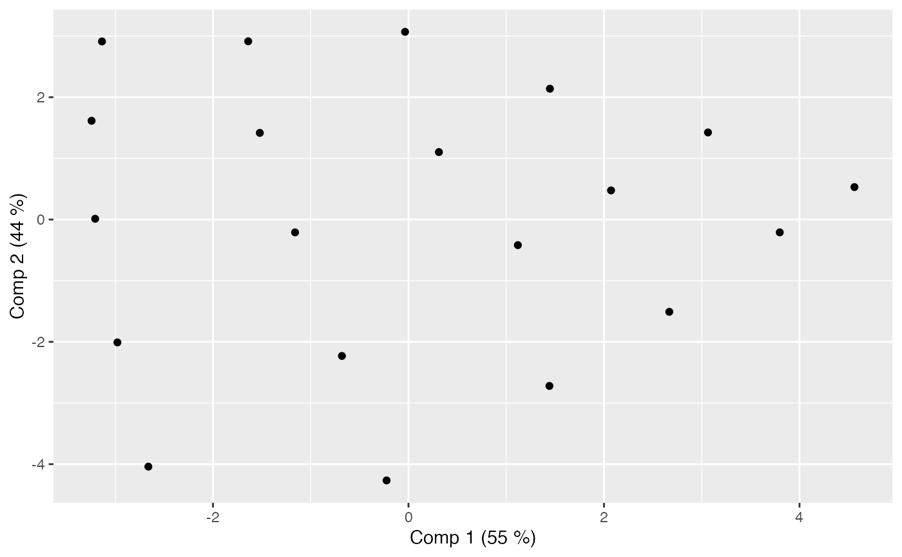
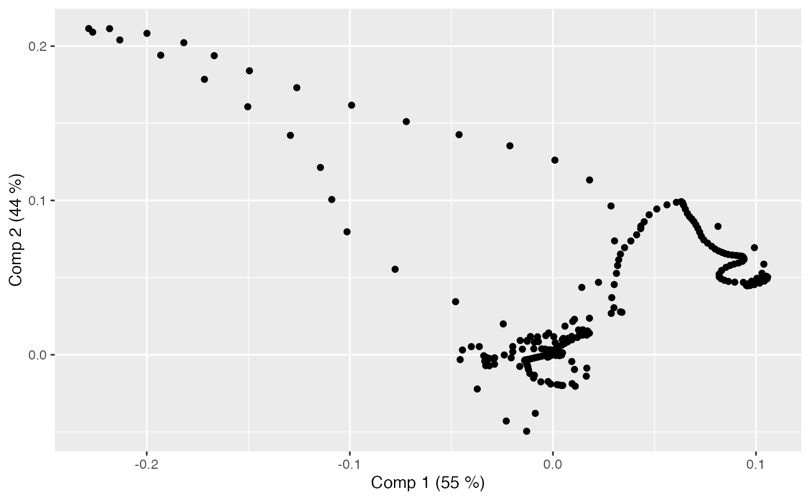
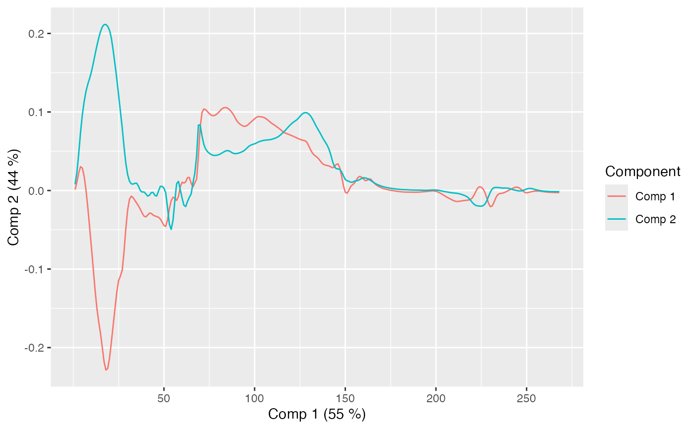
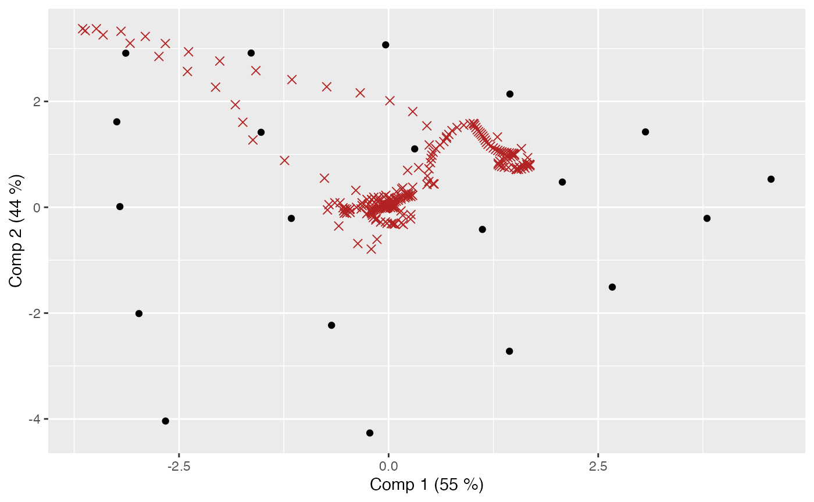
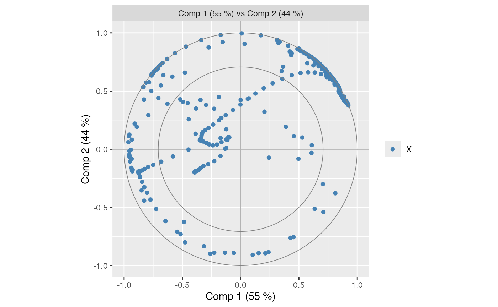
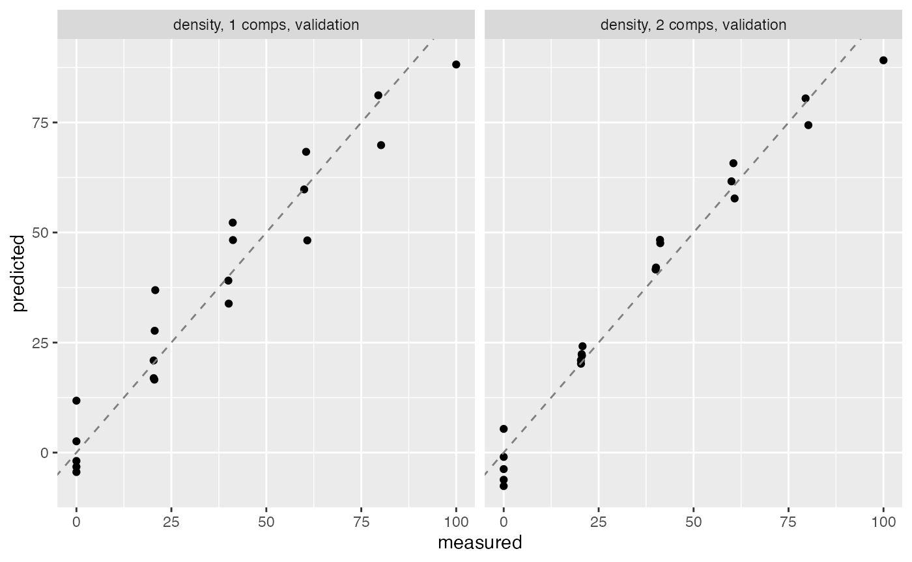
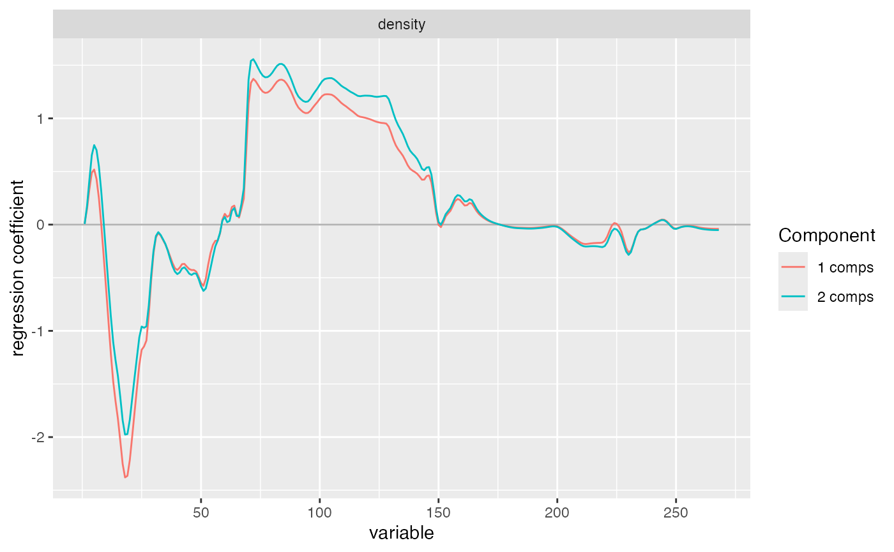
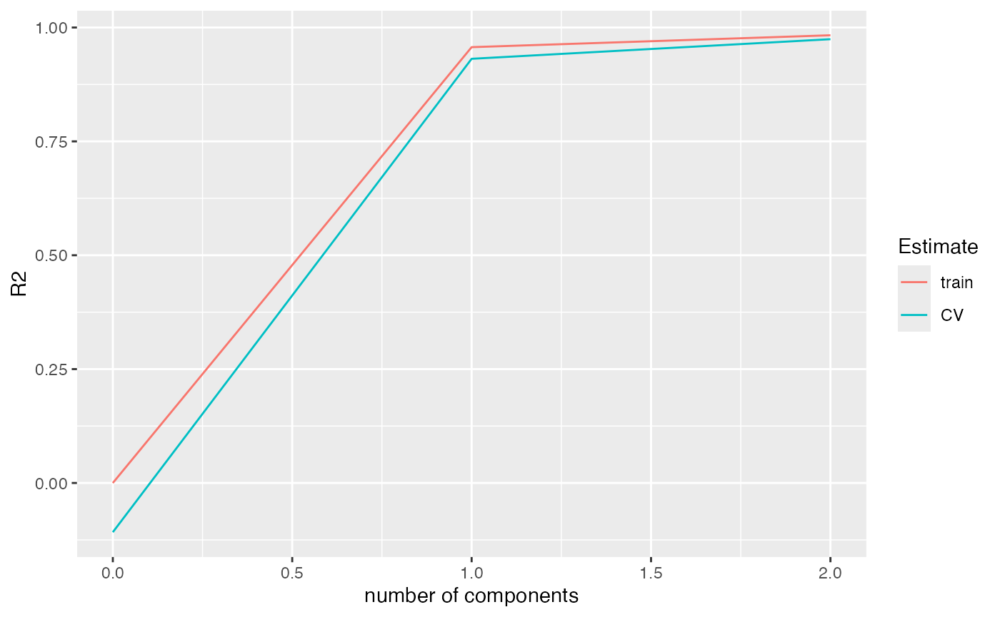
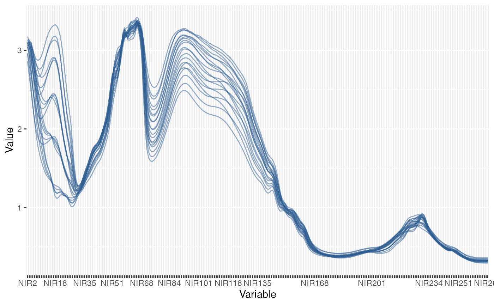

# ggplot2-tidyverse

## Fit a compact model

``` r

data(yarn)
d <- yarn[1:20, , drop = FALSE]
mod <- plsr(density ~ NIR, ncomp = 2, data = d, validation = "CV")
```

## Optional ggplot workflow

If **ggplot2** is installed, the model can be plotted through
[`autoplot()`](https://khliland.github.io/pls/reference/autoplot.md) or
the dedicated ggplot helpers.

### Score and loading plots

These are the basic plots for viewing the observations and variables
through subspace windows. While score plots are always in the form of
scatter plots, scatter can be turned on and off for loading plots
depending on what type of data are analysed.

``` r

gg_scoreplot(mod)
```



``` r

gg_loadingplot(mod, scatter = TRUE)
```



``` r

gg_loadingplot(mod)
```



### Optional interactive selection and refit

If **ggiraph** and **shiny** are installed, selected sample IDs can be
returned from `gg_scoreplot(select = TRUE)` and used with
[`refit()`](https://khliland.github.io/pls/reference/refit.md). This
makes for an intuitive, visual selection and refit procedure.

``` r

ids <- gg_scoreplot(mod, select = TRUE)
mod_drop <- refit(mod, selection = ids, exclude = TRUE)
mod_keep <- refit(mod, selection = ids, exclude = FALSE)
```

### Biplot and correlation plot

Scores and loadings can also be overlayed in joint scatter plots called
biplots. One can also show how much the variables are correlated to the
scores through correlation plots.

``` r

gg_biplot(mod)
```



``` r

gg_corrplot(mod)
```



### Prediction plot

Plots of predicted values vs measured values are obtained through
prediction plots.

``` r

gg_predplot(mod, ncomp = 1:2)
```



### Coefficient plot

Regression coefficients can be visualised through coefficient plots.

``` r

gg_coefplot(mod, ncomp = 1:2)
```



### Validation plot

Validation metrics can be shown using validation plots.

``` r

gg_valplot(mod, val.type = "R2", estimate = c("train", "CV"))
```



### Raw data plot

Finally, raw data can be visualised through raw data plots.

``` r

gg_rawdataplot(mod, plottype = "line")
```



### autplot()

All the plots above can also be produced using the autoplot() function
associated with ggplot2.

``` r

autoplot(mod, type = "scores")
autoplot(mod, type = "loadings")
autoplot(mod, type = "biplot")
autoplot(mod, type = "correlation")
autoplot(mod, type = "prediction")
autoplot(mod, type = "coefficients")
autoplot(mod, type = "validation", val.type = "R2", estimate = c("train", "CV"))
autoplot(mod, type = "rawdata", plottype = "line")
```

### Dashboards

The dashboard plots combine a set of plots to give an overview of the
main aspects of the model. The default is to show scores, loadings,
prediction and validation metrics as a ggplot2 or plotly panel.

``` r

# Static dashboard (draws in interactive sessions, returns a gtable invisibly)
gg_dashboard(
  mod,
  panel_args = list(prediction = list(ncomp = 2))
)

# HTML dashboard with Plotly panels
# The rendered object is an htmltools HTML container, not a raw plotly object.
gg_dashboard(
  mod,
  plotly = TRUE,
  panel_args = list(prediction = list(ncomp = 2))
)
```

## Tidyverse workflow

A compact, tidy-style workflow for `mvr` models is also supported by the
**pls** package, using the new methods:

- [`tidy()`](https://khliland.github.io/pls/reference/tidy.md) for
  long-format model components and validation outputs.
- [`glance()`](https://khliland.github.io/pls/reference/glance.md) for
  one-row model summaries.
- [`augment()`](https://khliland.github.io/pls/reference/augment.md) for
  sample-wise fitted values and residuals.

### Fit a compact model

``` r

data(yarn)
d <- yarn[1:20, , drop = FALSE]
mod <- plsr(density ~ NIR, ncomp = 2, data = d, validation = "CV")
```

### Tidy model components

``` r

comp_tbl <- tidy(mod, what = c("weights", "loadings", "coefficients"))
head(comp_tbl)
#>      kind name response component        value
#> 1 weights NIR1     <NA>         1 0.0008485053
#> 2 weights NIR2     <NA>         1 0.0122387159
#> 3 weights NIR3     <NA>         1 0.0277711693
#> 4 weights NIR4     <NA>         1 0.0404800917
#> 5 weights NIR5     <NA>         1 0.0430030762
#> 6 weights NIR6     <NA>         1 0.0355023891
```

### Tidy validation metrics

``` r

rmsep_tbl <- tidy(RMSEP(mod, estimate = c("train", "CV")))
head(rmsep_tbl)
#>   metric estimate response component       model cumulative     value
#> 1  RMSEP    train  density         0 (Intercept)       TRUE 29.569810
#> 2  RMSEP       CV  density         0 (Intercept)       TRUE 31.126116
#> 3  RMSEP    train  density         1     1 comps       TRUE  6.141607
#> 4  RMSEP       CV  density         1     1 comps       TRUE  8.175924
#> 5  RMSEP    train  density         2     2 comps       TRUE  3.859350
#> 6  RMSEP       CV  density         2     2 comps       TRUE  5.004901
```

### One-row summary with glance

``` r

glance(mod)
#>      method ncomp nobs nresp has_validation r2_train_mean rmsep_train_mean
#> 1 kernelpls     2   20     1           TRUE     0.9829654          3.85935
#>   r2_cv_mean rmsep_cv_mean
#> 1   0.971352      5.004901
```

### Sample-wise outputs with augment

``` r

aug_train <- augment(mod)
aug_train[1:5, -2]
#>   density .fitted_density .resid_density
#> 1  100.00        91.51127       8.488734
#> 2   80.22        75.42094       4.799062
#> 3   79.49        80.65194      -1.161940
#> 4   60.80        57.50089       3.299108
#> 5   59.97        61.35517      -1.385173
```

``` r

aug_new <- augment(mod, data = d[1:5, , drop = FALSE])
aug_new[, -1]
#>   density train .fitted_density
#> 1  100.00  TRUE        91.51127
#> 2   80.22  TRUE        75.42094
#> 3   79.49  TRUE        80.65194
#> 4   60.80  TRUE        57.50089
#> 5   59.97  TRUE        61.35517
```
