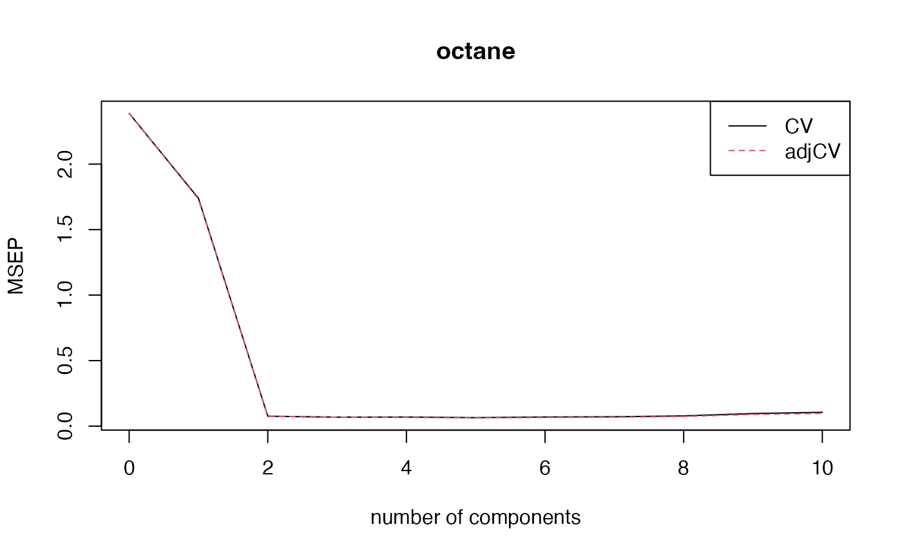

# Introduction to the pls Package

    ## 
    ## Attaching package: 'pls'

    ## The following object is masked from 'package:stats':
    ## 
    ##     loadings

## Abstract

The **pls** package implements Principal Component Regression (PCR) and
Partial Least Squares Regression (PLSR) in **R**, and is freely
available from the CRAN website, licensed under the Gnu General Public
License (GPL).

The user interface is modelled after the traditional formula interface,
as exemplified by `lm`. This was done so that people used to **R** would
not have to learn yet another interface, and also because we believe the
formula interface is a good way of working interactively with models. It
thus has methods for generic functions like `predict`, `update` and
`coef`. It also has more specialised functions like `scores`, `loadings`
and `RMSEP`, and a flexible cross-validation system. Visual inspection
and assessment is important in chemometrics, and the **pls** package has
a number of plot functions for plotting scores, loadings, predictions,
coefficients and RMSEP estimates.

The package implements PCR and several algorithms for PLSR. The design
is modular, so that it should be easy to use the underlying algorithms
in other functions. It is our hope that the package will serve well both
for interactive data analysis and as a building block for other
functions or packages using PLSR or PCR.

We will here describe the package and how it is used for data analysis,
as well as how it can be used as a part of other packages. Also included
is a section about formulas and data frames, for people not used to the
**R** modelling idioms.

## 1 Introduction

This vignette is meant as an introduction to the **pls** package. It is
based on the paper ‘The pls Package: Principal Component and Partial
Least Squares Regression in R’, published in *Journal of Statistical
Software* (Mevik and Wehrens 2007), but has been extended to reflect
further developments in the package. The PLSR methodology is shortly
described in Section 2. Section 3 presents an example session, to get an
overview of the package. In Section 4 we describe formulas and data
frames (as they are used in **pls**). Users familiar with formulas and
data frames in **R** can skip this section on first reading. Fitting of
models is described in Section 5, and cross-validatory choice of
components is discussed in Section 6. Next, inspecting and plotting
models is described (Section 7), followed by a section on predicting
future observations (Section 8). Finally, Section 9 covers more advanced
topics such as parallel computing, setting options, using the underlying
functions directly, and implementation details.

## 2 Theory

Multivariate regression methods like Principal Component Regression
(PCR) and Partial Least Squares Regression (PLSR) enjoy large popularity
in a wide range of fields, including the natural sciences. The main
reason is that they have been designed to confront the situation that
there are many, possibly correlated, predictor variables, and relatively
few samples—a situation that is common, especially in chemistry where
developments in spectroscopy since the seventies have revolutionised
chemical analysis. In fact, the origin of PLSR lies in chemistry (see,
e.g., (Wold 2001; Martens 2001)). The field of *near-infrared* (NIR)
spectroscopy, with its highly overlapping lines and difficult to
interpret overtones, would not have existed but for a method to obtain
quantitative information from the spectra. Also other fields have
benefited greatly from multivariate regression methods like PLSR and
PCR. In medicinal chemistry, for example, one likes to derive molecular
properties from the molecular structure. Most of these Quantitative
Structure-Activity Relations (QSAR, and also Quantitative
Structure-Property Relations, QSPR), and in particular, Comparative
Molecular Field Analysis (ComFA) (Cramer et al. 1988), use PLSR. Other
applications range from statistical process control (Kresta et al. 1991)
to tumour classification (Nguyen and Rocke 2002) to spatial analysis in
brain images (McIntosh et al. 1996) to marketing (Fornell and Bookstein
1982).

In the usual multiple linear regression (MLR) context, the least-squares
solution for

``` math
\begin{equation}
\mathbf{Y} = \mathbf{X}\mathbf{B} + \Epsilon
\end{equation}
```

is given by

``` math
\begin{equation}
\mathbf{B} = (\mathbf{X}^T \mathbf{X})^{-1} \mathbf{X}^T \mathbf{Y}
\label{eq:lsq}
\end{equation}
```

The problem often is that $`\mathbf{X}^T \mathbf{X}`$ is singular,
either because the number of variables (columns) in $`\mathbf{X}`$
exceeds the number of objects (rows), or because of collinearities. Both
PCR and PLSR circumvent this by decomposing $`\mathbf{X}`$ into
orthogonal scores $`\mathbf{T}`$ and loadings $`\mathbf{P}`$

``` math
\begin{equation}
\mathbf{X} = \mathbf{T} \mathbf{P}^T
\end{equation}
```

and regressing $`\mathbf{Y}`$ not on $`\mathbf{X}`$ itself but on the
first $`a`$ columns of the scores $`\mathbf{T}`$. In PCR, the scores are
given by the left singular vectors of $`\mathbf{X}`$, multiplied with
the corresponding singular values, and the loadings are the right
singular vectors of $`\mathbf{X}`$. This, however, only takes into
account information about $`\mathbf{X}`$, and therefore may be
suboptimal for prediction purposes. PLSR aims to incorporate information
on both $`\mathbf{X}`$ and $`\mathbf{Y}`$ in the definition of the
scores and loadings. In fact, for one specific version of PLSR, called
SIMPLS (Jong 1993), it can be shown that the scores and loadings are
chosen in such a way to describe as much as possible of the *covariance*
between $`\mathbf{X}`$ and $`\mathbf{Y}`$, where PCR concentrates on the
*variance* of $`\mathbf{X}`$. Other PLSR algorithms give identical
results to SIMPLS in the case of one $`\mathbf{Y}`$ variable, but
deviate slightly for the multivariate $`\mathbf{Y}`$ case ; the
differences are not likely to be important in practice.

### 2.1 Algorithms

In PCR, we approximate the $`\mathbf{X}`$ matrix by the first $`a`$
Principal Components (PCs), usually obtained from the singular value
decomposition (SVD):

``` math
\begin{equation}
\mathbf{X} = \tilde{\mathbf{X}}_{(a)} + \Epsilon_X
    = (\mathbf{U}_{(a)} \mathbf{D}_{(a)} ) \mathbf{V}^T_{(a)} + \Epsilon_X
    = \mathbf{T}_{(a)} \mathbf{P}_{(a)}^T + \Epsilon_X
\end{equation}
```

Next, we regress $`\mathbf{Y}`$ on the scores, which leads to regression
coefficients

``` math
\begin{equation}
\mathbf{B} = \mathbf{P} (\mathbf{T}^T \mathbf{T})^{-1} \mathbf{T}^T \mathbf{Y}
    = \mathbf{V} \mathbf{D}^{-1} \mathbf{U}^T \mathbf{Y}
\end{equation}
```

where the subscripts $`a`$ have been dropped for clarity. For PLSR, the
components, called Latent Variables (LVs) in this context, are obtained
iteratively. One starts with the SVD of the crossproduct matrix
$`\mathbf{S} = \mathbf{X}^T \mathbf{Y}`$, thereby including information
on variation in both $`\mathbf{X}`$ and $`\mathbf{Y}`$, and on the
correlation between them. The first left and right singular vectors,
$`w`$ and $`q`$, are used as weight vectors for $`\mathbf{X}`$ and
$`\mathbf{Y}`$, respectively, to obtain scores $`t`$ and $`u`$:

``` math
\begin{equation}
t = \mathbf{X} w = \mathbf{E} w
\end{equation}
```

``` math
\begin{equation}
u = \mathbf{Y} q = \mathbf{F} q
\end{equation}
```

where $`\mathbf{E}`$ and $`\mathbf{F}`$ are initialised as
$`\mathbf{X}`$ and $`\mathbf{Y}`$, respectively. The X scores $`t`$ are
often normalised:

``` math
\begin{equation}
t =  t / \sqrt{t^Tt}
\end{equation}
```

The Y scores $`u`$ are not actually necessary in the regression but are
often saved for interpretation purposes. Next, X and Y loadings are
obtained by regressing against the *same* vector $`t`$:

``` math
\begin{equation}
\label{eq:plspt}
p = \mathbf{E}^T t
\end{equation}
```
``` math
\begin{equation}
\label{eq:plsqt}
q = \mathbf{F}^T t
\end{equation}
```

Finally, the data matrices are ‘deflated’: the information related to
this latent variable, in the form of the outer products $`t p^T`$ and
$`t q^T`$, is subtracted from the (current) data matrices $`\mathbf{E}`$
and $`\mathbf{F}`$.

``` math
\begin{equation}
\mathbf{E}_{n+1} = \mathbf{E}_n - t p^T
\end{equation}
```
``` math
\begin{equation}
\mathbf{F}_{n+1} = \mathbf{F}_n - t q^T
\end{equation}
```

The estimation of the next component then can start from the SVD of the
crossproduct matrix $`\mathbf{E}_{n+1}^T\mathbf{F}_{n+1}`$. After every
iteration, vectors $`w`$, $`t`$, $`p`$ and $`q`$ are saved as columns in
matrices $`\mathbf{W}`$, $`\mathbf{T}`$, $`\mathbf{P}`$ and
$`\mathbf{Q}`$, respectively. One complication is that columns of matrix
$`\mathbf{W}`$ can not be compared directly: they are derived from
successively deflated matrices $`\mathbf{E}`$ and $`\mathbf{F}`$. It has
been shown that an alternative way to represent the weights, in such a
way that all columns relate to the original $`\mathbf{X}`$ matrix, is
given by

``` math
\begin{equation}
\mathbf{R} = \mathbf{W} (\mathbf{P}^T \mathbf{W})^{-1}
\end{equation}
```

Now, we are in the same position as in the PCR case: instead of
regressing $`\mathbf{Y}`$ on $`\mathbf{X}`$, we use scores
$`\mathbf{T}`$ to calculate the regression coefficients, and later
convert these back to the realm of the original variables by
pre-multiplying with matrix $`\mathbf{R}`$ (since
$`\mathbf{T} = \mathbf{X} \mathbf{R}`$):

``` math
\begin{equation}
\mathbf{B} = \mathbf{R} (\mathbf{T}^T \mathbf{T})^{-1} \mathbf{T}^T \mathbf{Y}
    = \mathbf{R} \mathbf{T}^T \mathbf{Y}
    = \mathbf{R} \mathbf{Q}^T
\end{equation}
```

Again, here, only the first $`a`$ components are used. How many
components are optimal has to be determined, usually by
cross-validation.

Many alternative formulations can be found in literature. It has been
shown, for instance, that only one of $`\mathbf{X}`$ and $`\mathbf{Y}`$
needs to be deflated ; alternatively, one can directly deflate the
crossproduct matrix $`\mathbf{S}`$ (as is done in SIMPLS, for example).
Moreover, there are many equivalent ways of scaling. In the example
above, the scores $`t`$ have been normalised, but one can also choose to
introduce normalisation at another point in the algorithm.
Unfortunately, this can make it difficult to directly compare the scores
and loadings of different PLSR implementations.

### 2.2 On the use of PLSR and PCR

In theory, PLSR should have an advantage over PCR. One could imagine a
situation where a minor component in $`\mathbf{X}`$ is highly correlated
with $`\mathbf{Y}`$ ; not selecting enough components would then lead to
very bad predictions. In PLSR, such a component would be automatically
present in the first LV. In practice, however, there is hardly any
difference between the use of PLSR and PCR ; in most situations, the
methods achieve similar prediction accuracies, although PLSR usually
needs fewer latent variables than PCR. Put the other way around: with
the same number of latent variables, PLSR will cover more of the
variation in $`\mathbf{Y}`$ and PCR will cover more of $`\mathbf{X}`$.
In turn, both behave very similar to ridge regression (Frank and
Friedman 1993).

It can also be shown that both PCR and PLSR behave as shrinkage methods
(Hastie et al. 2001), although in some cases PLSR seems to increase the
variance of individual regression coefficients, one possible explanation
of why PLSR is not always better than PCR.

## 3 Example session

In this section we will walk through an example session, to get an
overview of the package. To be able to use the package, one first has to
load it:

``` r

library(pls)
```

This prints a message telling that the package has been attached, and
that the package implements a function `loadings` that masks a function
of the same name in package **stats**. (The output of the commands have
in some cases been suppressed to save space.)

Four example data sets are included in **pls**:

- **`yarn`**: A data set with 28 near-infrared spectra (`NIR`) of PET
  yarns, measured at 268 wavelengths, as predictors, and density as
  response (`density`) (Swierenga et al. 1999). The data set also
  includes a logical variable `train` which can be used to split the
  data into a training data set of size 21 and test data set of size 7.
  See [`?yarn`](https://khliland.github.io/pls/reference/yarn.md) for
  details.
- **`oliveoil`**: A data set with 5 quality measurements (`chemical`)
  and 6 panel sensory panel variables (`sensory`) made on 16 olive oil
  samples (Massart et al. 1998). See
  [`?oliveoil`](https://khliland.github.io/pls/reference/oliveoil.md)
  for details.
- **`gasoline`**: A data set consisting of octane number (`octane`) and
  NIR spectra (`NIR`) of 60 gasoline samples (Kalivas 1997). Each NIR
  spectrum consists of 401 diffuse reflectance measurements from 900 to
  1700 nm. See
  [`?gasoline`](https://khliland.github.io/pls/reference/gasoline.md)
  for details.
- **`mayonnaise`**: A data set consisting of oil type (`oil.type`),
  experimental design (`design`), train-test split (`train`) and NIR
  spectra (`NIR`) of 162 mayonnaise samples (Indahl et al. 1999). Each
  NIR spectrum consists of 351 measurements from 1100 to 2500 nm. See
  [`?mayonnaise`](https://khliland.github.io/pls/reference/mayonnaise.md)for
  details.

These will be used in the examples that follow. To use the data sets,
they must first be loaded:

``` r

data(yarn)
data(oliveoil)
data(gasoline)
data(mayonnaise)
```

For the rest of the paper, it will be assumed that the package and the
data sets have been loaded as above. Also, all examples are run with
`options(digits = 4)`.


Gasoline NIR spectra

In this section, we will do a PLSR on the `gasoline` data to illustrate
the use of **pls**. The spectra are shown in Figure 1. We first divide
the data set into train and test data sets:

``` r

gasTrain <- gasoline[1:50,]
gasTest <- gasoline[51:60,]
```

A typical way of fitting a PLSR model is

``` r

gas1 <- plsr(octane ~ NIR, ncomp = 10, data = gasTrain, validation = "LOO")
```

This fits a model with 10 components, and includes *leave-one-out* (LOO)
cross-validated predictions (Lachenbruch and Mickey 1968). We can get an
overview of the fit and validation results with the `summary` method:

``` r

summary(gas1)
```

    ## Data:    X dimension: 50 401 
    ##  Y dimension: 50 1
    ## Fit method: kernelpls
    ## Number of components considered: 10
    ## 
    ## VALIDATION: RMSEP
    ## Cross-validated using 50 leave-one-out segments.
    ##        (Intercept)  1 comps  2 comps  3 comps  4 comps  5 comps  6 comps
    ## CV           1.545    1.357   0.2966   0.2524   0.2476   0.2398   0.2319
    ## adjCV        1.545    1.356   0.2947   0.2521   0.2478   0.2388   0.2313
    ##        7 comps  8 comps  9 comps  10 comps
    ## CV      0.2386   0.2316   0.2449    0.2673
    ## adjCV   0.2377   0.2308   0.2438    0.2657
    ## 
    ## TRAINING: % variance explained
    ##         1 comps  2 comps  3 comps  4 comps  5 comps  6 comps  7 comps  8 comps
    ## X         78.17    85.58    93.41    96.06    96.94    97.89    98.38    98.85
    ## octane    29.39    96.85    97.89    98.26    98.86    98.96    99.09    99.16
    ##         9 comps  10 comps
    ## X         99.02     99.19
    ## octane    99.28     99.39

The validation results here are *Root Mean Squared Error of Prediction*
(RMSEP). There are two cross-validation estimates: `CV` is the ordinary
CV estimate, and `adjCV` is a bias-corrected CV estimate (Mevik and
Cederkvist 2004). (For a LOO CV, there is virtually no difference) .

It is often simpler to judge the RMSEPs by plotting them:

``` r

plot(RMSEP(gas1), legendpos = "topright")
```


Cross-validated RMSEP curves for the gasoline data

This plots the estimated RMSEPs as functions of the number of components
(Figure 2). The `legendpos` argument adds a legend at the indicated
position. Two components seem to be enough. This gives an RMSEP of
0.297.

As mentioned in the introduction, the main practical difference between
PCR and PLSR is that PCR often needs more components than PLSR to
achieve the same prediction error. On this data set, PCR would need
three components to achieve the same RMSEP. Once the number of
components has been chosen, one can inspect different aspects of the fit
by plotting predictions, scores, loadings, etc. The default plot is a
prediction plot:

``` r

plot(gas1, ncomp = 2, asp = 1, line = TRUE)
```


Cross-validated predictions for the gasoline data

This shows the cross-validated predictions with two components versus
measured values (Figure 3). We have chosen an aspect ratio of 1, and to
draw a target line. The points follow the target line quite nicely, and
there is no indication of a curvature or other anomalies. Other plots
can be selected with the argument `plottype`:

``` r

plot(gas1, plottype = "scores", comps = 1:3)
```


Score plot for the gasoline data

This gives a pairwise plot of the score values for the three first
components (Figure 4). Score plots are often used to look for patterns,
groups or outliers in the data. (For instance, plotting the two first
components for a model built on the `yarn` dataset clearly indicates the
experimental design of that data.) In this example, there is no clear
indication of grouping or outliers. The numbers in parentheses after the
component labels are the relative amount of X variance explained by each
component. The explained variances can be extracted explicitly with

``` r

explvar(gas1)
```

    ##  Comp 1  Comp 2  Comp 3  Comp 4  Comp 5  Comp 6  Comp 7  Comp 8  Comp 9 Comp 10 
    ## 78.1708  7.4122  7.8242  2.6578  0.8768  0.9466  0.4922  0.4723  0.1688  0.1694

The loading plot (Figure 5) is much used for interpretation purposes,
for instance to look for known spectral peaks or profiles:

``` r

par(mar = c(4, 4, 0.3, 1) + 0.1)
plot(gas1, "loadings", comps = 1:2, legendpos = "topleft",
     labels = "numbers", xlab = "nm")
abline(h = 0)
```


Loading plot for the gasoline data

The `labels = "numbers"` argument makes the plot function try to
interpret the variable names as numbers, and use them as $`x`$ axis
labels. Score and loading plots also have their own plotting functions,
`scoreplot` and `loadingplot`, which have more options for plotting
scores and loadings, respectively. For instance, `scoreplot`and its
companion extractor `scores` has the same argument as `RMSEP/MSEP/R2`
called `estimate`, which can be used to plot cross-validated scores or
test data scores, e.g.,

``` r

par.old <- par(mfrow=c(1,2))
scoreplot(gas1)
scoreplot(gas1, estimate="CV")
```


Calibrated and cross-validated score plots for the gasoline data

``` r

par(par.old)
```

A fitted model is often used to predict the response values of new
observations. The following predicts the responses for the ten
observations in `gasTest`, using two components:

``` r

predict(gas1, ncomp = 2, newdata = gasTest)
```

    ## , , 2 comps
    ## 
    ##    octane
    ## 51  87.94
    ## 52  87.25
    ## 53  88.16
    ## 54  84.97
    ## 55  85.15
    ## 56  84.51
    ## 57  87.56
    ## 58  86.85
    ## 59  89.19
    ## 60  87.09

Because we know the true response values for these samples, we can
calculate the test set RMSEP:

``` r

RMSEP(gas1, newdata = gasTest)
```

    ## (Intercept)      1 comps      2 comps      3 comps      4 comps      5 comps  
    ##      1.5369       1.1696       0.2445       0.2341       0.3287       0.2780  
    ##     6 comps      7 comps      8 comps      9 comps     10 comps  
    ##      0.2703       0.3301       0.3571       0.4090       0.6116

For two components, we get 0.244, which is quite close to the
cross-validated estimate above (0.297).

## 4 Formulas and data frames

The **pls** package has a formula interface that works like the formula
interface in **R**’s standard `lm` functions, in most ways. This section
gives a short description of formulas and data frames as they apply to
**pls**. More information on formulas can be found in the `lm` help
file, in Chapter 11 of ‘An Introduction to R’, and in Chapter 2 of ‘The
White Book’ (Chambers and Hastie 1992). These are good reads for anyone
wanting to understand how **R** works with formulas, and the user is
strongly advised to read them.

### 4.1 Formulas

A *formula* consists of a *left hand side* (lhs), a tilde (`~`), and a
*right hand side* (rhs). The lhs consists of a single term, representing
the response(s). The rhs consists of one or more terms separated by `+`,
representing the regressor(s). For instance, in the formula
`a ~ b + c + d`, `a` is the response, and `b`, `c`, and `d` are the
regressors. The intercept is handled automatically, and need not be
specified in the formula. Each term represents a matrix, a numeric
vector or a factor (a factor should not be used as the response). If the
response term is a matrix, a multi-response model is fit. In **pls**,
the right hand side quite often consists of a single term, representing
a matrix regressor: `y ~ X`. It is also possible to specify
transformations of the variables. For instance, `log(y) ~ msc(Z)`
specifies a regression of the logarithm of `y` onto `Z` after `Z` has
been transformed by *Multiplicative Scatter (or Signal) Correction*
(MSC) (Geladi et al. 1985), a pre-treatment that is very common in
infrared spectroscopy. If the transformations contain symbols that are
interpreted in the formula handling, e.g., `+`, `*` or `^`, the terms
should be protected with the [`I()`](https://rdrr.io/r/base/AsIs.html)
function, like this: `y ~ x1 + I(x2 + x3)`. This specifies *two*
regressors: `x1`, and the sum of `x2` and `x3`.

### 4.2 Data frames

The fit functions first look for the specified variables in a supplied
data frame, and it is advisable to collect all variables there. This
makes it easier to know what data has been used for fitting, to keep
different variants of the data around, and to predict new data. To
create a data frame, one can use the `data.frame` function: if `v1`,
`v2` and `v3` are factors or numeric vectors,
`mydata <- data.frame(y = v1, a = v2, b = v3)` will result in a data
frame with variables named `y`, `a` and `b`. PLSR and PCR are often used
with a matrix as the single predictor term (especially when one is
working with spectroscopic data). Also, multi-response models require a
matrix as the response term. If `Z` is a matrix, it has to be protected
by the ‘protect function’ [`I()`](https://rdrr.io/r/base/AsIs.html) in
calls to `data.frame`: `mydata <- data.frame(..., Z = I(Z))`. Otherwise,
it will be split into separate variables for each column, and there will
be no variable called `Z` in the data frame, so we cannot use `Z` in the
formula. One can also add the matrix to an existing data frame:

    > mydata <- data.frame(...)
    > mydata$Z <- Z

This will also prevent `Z` from being split into separate variables.
Finally, one can use `cbind` to combine vectors and matrices into
matrices on the fly in the formula. This is most useful for the
response, e.g., `cbind(y1, y2) ~ X`. Variables in a data frame can be
accessed with the `$` operator, e.g., `mydata$y`. However, the **pls**
functions access the variables automatically, so the user should never
use `$` in formulas.

## 5 Fitting models

The main functions for fitting models are `pcr` and `plsr`. (They are
simply wrappers for the function `mvr`, selecting the appropriate fit
algorithm) . We will use `plsr` in the examples in this section, but
everything could have been done with `pcr` (or `mvr`). In its simplest
form, the function call for fitting models is
`plsr(formula, ncomp, data)` (where `plsr` can be substituted with `pcr`
or `mvr`). The argument `formula` is a formula as described above,
`ncomp` is the number of components one wishes to fit, and `data` is the
data frame containing the variables to use in the model. The function
returns a fitted model (an object of class `"mvr"`) which can be
inspected (Section 7) or used for predicting new observations (Section
8). For instance:

``` r

dens1 <- plsr(density ~ NIR, ncomp = 5, data = yarn)
```

If the response term of the formula is a matrix, a multi-response model
is fit, e.g.,:

``` r

dim(oliveoil$sensory)
```

    ## [1] 16  6

``` r

plsr(sensory ~ chemical, data = oliveoil)
```

    ## Partial least squares regression, fitted with the kernel algorithm.
    ## Call:
    ## pls::plsr(formula = sensory ~ chemical, data = oliveoil)

(As we see, the `print` method simply tells us what type of model this
is, and how the fit function was called.)

The argument `ncomp` is optional. If it is missing, the maximal possible
number of components are used. Also `data` is optional, and if it is
missing, the variables specified in the formula is searched for in the
global environment (the user’s workspace). Usually, it is preferable to
keep the variables in data frames, but it can sometimes be convenient to
have them in the global environment. If the variables reside in a data
frame, e.g. `yarn`, *do not* be tempted to use formulas like
`yarn$density ~ yarn$NIR`! Use `density ~ NIR` and specify the data
frame with `data = yarn` as above. There are facilities for working
interactively with models. To use only part of the samples in a data
set, for instance the first 20, one can use arguments `subset = 1:20` or
`data = yarn[1:20,]`. Also, if one wants to try different alternatives
of the model, one can use the function `update`. For instance

``` r

trainind <- which(yarn$train == TRUE)
dens2 <- update(dens1, subset = trainind)
```

will refit the model `dens1` using only the observations which are
marked as `TRUE` in `yarn$train`, and

``` r

dens3 <- update(dens1, ncomp = 10)
```

will change the number of components to 10. Other arguments, such as
`formula`, can also be changed with `update`. This can save a bit of
typing when working interactively with models (but it doesn’t save
computing time; the model is refitted each time). In general, the reader
is referred to ‘The White Book’ (Chambers and Hastie 1992) or ‘An
Introduction to R’ for more information about fitting and working with
models in **R**.

Missing data can sometimes be a problem. The PLSR and PCR algorithms
currently implemented in **pls** do not handle missing values
intrinsically, so observations with missing values must be removed. This
can be done with the `na.action` argument. With `na.action = na.omit`
(the default), any observation with missing values will be removed from
the model completely. With `na.action = na.exclude`, they will be
removed from the fitting process, but included as `NA`s in the residuals
and fitted values. If you want an explicit error when there are missing
values in the data, use `na.action = na.fail`. The default `na.action`
can be set with [`options()`](https://rdrr.io/r/base/options.html),
e.g., `options(na.action = quote(na.fail))`.

Standardisation and other pre-treatments of predictor variables are
often called for. In **pls**, the predictor variables are always
centered, as a part of the fit algorithm. Scaling can be requested with
the `scale` argument. If `scale` is `TRUE`, each variable is
standardised by dividing it by its standard deviation, and if `scale` is
a numeric vector, each variable is divided by the corresponding number.
For instance, this will fit a model with standardised chemical
measurements:

``` r

olive1 <- plsr(sensory ~ chemical, scale = TRUE, data = oliveoil)
```

As mentioned earlier, MSC (Geladi et al. 1985) is implemented in **pls**
as a function `msc` that can be used in formulas:

``` r

gas2 <- plsr(octane ~ msc(NIR), ncomp = 10, data = gasTrain)
```

This scatter corrects `NIR` prior to the fitting, and arranges for new
spectra to be automatically scatter corrected (using the same reference
spectrum as when fitting) in `predict`:

``` r

predict(gas2, ncomp = 3, newdata = gasTest)
```

There are other arguments that can be given in the fit call:
`validation` is for selecting validation, and `...` is for sending
arguments to the underlying functions, notably the cross-validation
function `mvrCv`. For the other arguments, see
[`?mvr`](https://khliland.github.io/pls/reference/mvr.md).

## 6 Choosing the number of components with cross-validation

Cross-validation, commonly used to determine the optimal number of
components to take into account, is controlled by the `validation`
argument in the modelling functions (`mvr`, `plsr` and `pcr`). The
default value is `"none"`. Supplying a value of `"CV"` or `"LOO"` will
cause the modelling procedure to call `mvrCv` to perform
cross-validation; `"LOO"` provides leave-one-out cross-validation,
whereas `"CV"` divides the data into segments. Default is to use ten
segments, randomly selected, but also segments of consecutive objects or
interleaved segments (sometimes also referred to as ‘Venetian blinds’)
are possible through the use of the argument `segment.type`. One can
also specify the segments explicitly with the argument `segments`; see
[`?mvrCv`](https://khliland.github.io/pls/reference/mvrCv.md) for
details. When validation is performed in this way, the model will
contain an element comprising information on the out-of-bag predictions
(in the form of predicted values, as well as MSEP and R2 values). As a
reference, the MSEP error using no components at all is calculated as
well. The validation results can be visualised using the
`plottype = "validation"` argument of the standard plotting function. An
example is shown in Figure 2 for the gasoline data; typically, one would
select a number of components after which the cross-validation error
does not show a significant decrease. The decision on how many
components to retain will to some extent always be subjective. However,
especially when building large numbers of models (e.g., in simulation
studies), it can be crucial to have a consistent strategy on how to
choose the “optimal” number of components. Two such strategies have been
implemented in function `selectNcomp`. The first is based on the
so-called one-sigma heuristic (Hastie et al. 2013) and consists of
choosing the model with fewest components that is still less than one
standard error away from the overall best model. The second strategy
employs a permutation approach, and basically tests whether adding a new
component is beneficial at all (Voet 1994). It is implemented backwards,
again taking the global minimum in the crossvalidation curve as a
starting point, and assessing models with fewer and fewer components: as
long as no significant deterioration in performance is found (by default
on the $`\alpha = 0.01`$ level), the algorithm continues to remove
components. Applying the function is quite straightforward:

``` r

ncomp.onesigma <- selectNcomp(gas2, method = "onesigma", plot = TRUE,
                              ylim = c(.18, .6))
ncomp.permut <- selectNcomp(gas2, method = "randomization", plot = TRUE,
                            ylim = c(.18, .6))
```

This leads to the plots in Figure 6 – note that graphical arguments can
be supplied to customize the plots. In both cases, the global minimum of
the crossvalidation curve is indicated with gray dotted lines, and the
suggestion for the optimal number of components with a vertical blue
dashed line. The left plot shows the width of the one-sigma intervals on
which the suggestion is based ; the right plot indicates which models
have been assessed by the permutation approach through the large blue
circles. The two criteria do not always agree (as in this case) but
usually are quite close.


The two strategies for suggesting optimal model dimensions: the left
plot shows the one-sigma strategy, the right plot the permutation
strategy.

When a pre-treatment that depends on the composition of the training set
is applied, the cross-validation procedure as described above is not
optimal, in the sense that the cross-validation errors are biased
downward. As long as the only purpose is to select the optimal number of
components, this bias may not be very important, but it is not too
difficult to avoid it. The modelling functions have an argument `scale`
that can be used for auto-scaling per segment. However, more elaborate
methods such as MSC need explicit handling per segment. For this, the
function `crossval` is available. It takes an `mvr` object and performs
the cross-validation as it should be done: applying the pre-treatment
for each segment. The results can be shown in a plot (which looks very
similar to Figure 2) or summarised in numbers.

``` r

gas2.cv <- crossval(gas2, segments = 10)
plot(MSEP(gas2.cv), legendpos="topright")
```



``` r

summary(gas2.cv, what = "validation")
```

    ## Data:    X dimension: 50 401 
    ##  Y dimension: 50 1
    ## Fit method: kernelpls
    ## Number of components considered: 10
    ## 
    ## VALIDATION: RMSEP
    ## Cross-validated using 10 random segments.
    ##        (Intercept)  1 comps  2 comps  3 comps  4 comps  5 comps  6 comps
    ## CV           1.545    1.319   0.2754   0.2614   0.2630   0.2546   0.2636
    ## adjCV        1.545    1.316   0.2745   0.2601   0.2582   0.2500   0.2571
    ##        7 comps  8 comps  9 comps  10 comps
    ## CV      0.2671   0.2794   0.3098    0.3250
    ## adjCV   0.2605   0.2713   0.2986    0.3119

Applying MSC in this case leads to nearly identical cross-validation
estimates of prediction error. When the scaling does not depend on the
division of the data into segments (e.g., log-scaling), functions
`crossval` and `mvrCv` give the same results ; however, `crossval` is
much slower.

Cross-validation can be computationally demanding (especially when using
the function `crossval`). Therefore, both `mvrCv` and `crossval` can
perform the calculations in parallel on a multi-core machine or on
several machines. How to do this is described in Section 9.2.

## 7 Inspecting fitted models

A closer look at the fitted model may reveal interesting agreements or
disagreements with what is known about the relations between X and Y.
Several functions are implemented in **pls** for plotting, extracting
and summarising model components.

### 7.1 Plotting

One can access all plotting functions through the `"plottype"` argument
of the `plot` method for `mvr` objects. This is simply a wrapper
function calling the actual plot functions; the latter are available to
the user as well. The default plot is a prediction plot (`predplot`),
showing predicted versus measured values. Test set predictions are used
if a test set is supplied with the `newdata` argument. Otherwise, if the
model was built using cross-validation, the cross-validated predictions
are used, otherwise the predictions for the training set. This can be
overridden with the `which` argument. An example of this type of plot
can be seen in Figure 3. An optional argument can be used to indicate
how many components should be included in the prediction. To assess how
many components are optimal, a validation plot (`validationplot`) can be
used such as the one shown in Figure 2; this shows a measure of
prediction performance (either RMSEP, MSEP, or $`R^2`$) against the
number of components. Usually, one takes the first local minimum rather
than the absolute minimum in the curve, to avoid over-fitting. The
regression coefficients can be visualised using `plottype = "coef"` in
the `plot` method, or directly through function `coefplot`. This allows
simultaneous plotting of the regression vectors for several different
numbers of components at once. The regression vectors for the `gasoline`
data set using MSC are shown in Figure 7 using the command

``` r

plot(gas1, plottype = "coef", ncomp=1:3, legendpos = "bottomleft",
     labels = "numbers", xlab = "nm")
```


Regression coefficients for the gasoline data

Note that the coefficients for two components and three components are
similar. This is because the third component contributes little to the
predictions. The RMSEPs (see Figure 2) and predictions (see Section 8)
for two and three components are quite similar. Scores and loadings can
be plotted using functions `scoreplot` (an example is shown in Figure 4)
and `loadingplot` (in Figure 5), respectively. One can indicate the
number of components with the `comps` argument ; if more than two
components are given, plotting the scores will give a pairs plot,
otherwise a scatter plot. For `loadingplot`, the default is to use line
plots.

Finally, a ‘correlation loadings’ plot (function `corrplot`, or
`plottype = "correlation"` in `plot`) shows the correlations between
each variable and the selected components (see Figure 8). These plots
are scatter plots of two sets of scores with concentric circles of radii
given by `radii`. Each point corresponds to an X variable. The squared
distance between the point and the origin equals the fraction of the
variance of the variable explained by the components in the panel. The
default values for `radii` correspond to 50% and 100% explained
variance, respectively.


Correlation loadings plot for the gasoline data

The plot functions accept most of the ordinary plot parameters, such as
`col` and `pch`. If the model has several responses or one selects more
than one model size, e.g. `ncomp = 4:6`, in some plot functions (notably
prediction plots (see below), validation plots and coefficient plots)
the plot window will be divided and one plot will be shown for each
combination of response and model size. The number of rows and columns
are chosen automatically, but can be specified explicitly with arguments
`nRows` and `nCols`. If there are more plots than fit the plot window,
one will be asked to press return to see the rest of the plots.

### 7.2 Extraction

Regression coefficients can be extracted using the generic function
`coef`; the function takes several arguments, indicating the number of
components to take into account, and whether the intercept is needed
(default is `FALSE`). Scores and loadings can be extracted using
functions `scores` and `loadings` for X, and `Yscores` and `Yloadings`
for Y. These also return the percentage of variance explained as
attributes. In PLSR, weights can be extracted using the function
`loading.weights`. When applied to a PCR model, the function returns
`NULL`. Note that commands like `plot(scores(gas1))` are perfectly
correct, and lead to exactly the same plots as using `scoreplot`. The
`vcov` function can be used to get the covariance matrix of `pcr`
models, e.g., for uncertainty plotting (see
[`?vcov.mvr`](https://khliland.github.io/pls/reference/vcov.mvr.md)).

### 7.3 Summaries

The `print` method for an object of class `"mvr"` shows the regression
type used, perhaps indicating the form of validation employed, and shows
the function call. The `summary` method gives more information: it also
shows the amount of variance explained by the model (for all choices of
$`a`$, the number of latent variables). The `summary` method has an
additional argument (`what`) to be able to focus on the training phase
or validation phase, respectively. Default is to print both types of
information.

### 7.4 Tidy outputs

For workflows that use long-format data frames, **pls** provides `tidy`,
`glance` and `augment` methods for `mvr` objects, and a `tidy` method
for validation objects such as `RMSEP`.

``` r

data(yarn)
d <- yarn[1:20, , drop = FALSE]
mod_tidy <- plsr(density ~ NIR, ncomp = 2, data = d, validation = "CV")

# Long-format model components
head(tidy(mod_tidy, what = c("weights", "loadings", "coefficients")))
```

    ##      kind name response component     value
    ## 1 weights NIR1     <NA>         1 0.0008485
    ## 2 weights NIR2     <NA>         1 0.0122387
    ## 3 weights NIR3     <NA>         1 0.0277712
    ## 4 weights NIR4     <NA>         1 0.0404801
    ## 5 weights NIR5     <NA>         1 0.0430031
    ## 6 weights NIR6     <NA>         1 0.0355024

``` r

# Long-format validation metrics
head(tidy(RMSEP(mod_tidy, estimate = c("train", "CV"))))
```

    ##   metric estimate response component       model cumulative  value
    ## 1  RMSEP    train  density         0 (Intercept)       TRUE 29.570
    ## 2  RMSEP       CV  density         0 (Intercept)       TRUE 31.126
    ## 3  RMSEP    train  density         1     1 comps       TRUE  6.142
    ## 4  RMSEP       CV  density         1     1 comps       TRUE  7.175
    ## 5  RMSEP    train  density         2     2 comps       TRUE  3.859
    ## 6  RMSEP       CV  density         2     2 comps       TRUE  4.781

``` r

# One-row summary
glance(mod_tidy)
```

    ##      method ncomp nobs nresp has_validation r2_train_mean rmsep_train_mean
    ## 1 kernelpls     2   20     1           TRUE         0.983            3.859
    ##   r2_cv_mean rmsep_cv_mean
    ## 1     0.9739         4.781

``` r

# Training data with fitted values and residuals
head(augment(mod_tidy))
```

    ##   density  NIR.1  NIR.2  NIR.3  NIR.4  NIR.5  NIR.6  NIR.7  NIR.8  NIR.9 NIR.10
    ## 1  100.00 3.0663 3.0861 3.1079 3.0972 2.9979 2.8273 2.6233 2.4039 2.1931 2.0058
    ## 2   80.22 3.0675 3.0857 3.0958 3.0692 2.9818 2.8408 2.6760 2.5059 2.3506 2.2230
    ## 3   79.49 3.0750 3.0966 3.0916 3.0288 2.8849 2.6885 2.4764 2.2694 2.0824 1.9195
    ## 4   60.80 3.0828 3.0973 3.1010 3.0735 2.9913 2.8709 2.7392 2.6102 2.5000 2.4237
    ## 5   59.97 3.1029 3.1034 3.0848 3.0228 2.8927 2.7159 2.5384 2.3764 2.2397 2.1346
    ## 6   60.48 3.0815 3.0849 3.0487 2.9305 2.7323 2.5089 2.2944 2.0995 1.9328 1.7925
    ##   NIR.11 NIR.12 NIR.13 NIR.14 NIR.15 NIR.16 NIR.17 NIR.18 NIR.19 NIR.20 NIR.21
    ## 1 1.8379 1.6907 1.5777 1.5033 1.4381 1.3373 1.2206 1.1410 1.1161 1.1329 1.1604
    ## 2 2.1192 2.0352 1.9795 1.9554 1.9396 1.8931 1.8198 1.7550 1.7122 1.6832 1.6461
    ## 3 1.7747 1.6490 1.5533 1.4907 1.4363 1.3540 1.2603 1.1979 1.1788 1.1900 1.2053
    ## 4 2.3774 2.3526 2.3506 2.3721 2.4009 2.4042 2.3756 2.3321 2.2768 2.2053 2.1085
    ## 5 2.0534 1.9909 1.9522 1.9393 1.9337 1.9047 1.8535 1.8047 1.7650 1.7266 1.6753
    ## 6 1.6693 1.5633 1.4836 1.4310 1.3851 1.3193 1.2468 1.1999 1.1851 1.1896 1.1931
    ##   NIR.22 NIR.23 NIR.24 NIR.25 NIR.26 NIR.27 NIR.28 NIR.29 NIR.30 NIR.31 NIR.32
    ## 1 1.1638 1.1527 1.1515 1.1277 1.0681 1.0197 1.0084 1.0321 1.0828 1.1408 1.1788
    ## 2 1.5810 1.5091 1.4521 1.3802 1.2865 1.2045 1.1508 1.1308 1.1438 1.1761 1.2041
    ## 3 1.1985 1.1804 1.1727 1.1513 1.1042 1.0665 1.0593 1.0807 1.1245 1.1751 1.2105
    ## 4 1.9815 1.8544 1.7459 1.6310 1.5083 1.3954 1.2976 1.2297 1.2022 1.2088 1.2278
    ## 5 1.5999 1.5207 1.4575 1.3898 1.3114 1.2421 1.1904 1.1630 1.1655 1.1901 1.2163
    ## 6 1.1778 1.1538 1.1405 1.1220 1.0875 1.0604 1.0562 1.0742 1.1106 1.1542 1.1873
    ##   NIR.33 NIR.34 NIR.35 NIR.36 NIR.37 NIR.38 NIR.39 NIR.40 NIR.41 NIR.42 NIR.43
    ## 1 1.2018 1.2349 1.2776 1.3125 1.3431 1.3766 1.4145 1.4571 1.5031 1.5457 1.5762
    ## 2 1.2292 1.2690 1.3180 1.3574 1.3924 1.4335 1.4792 1.5239 1.5657 1.6045 1.6366
    ## 3 1.2357 1.2724 1.3204 1.3659 1.4096 1.4529 1.4976 1.5460 1.5938 1.6320 1.6575
    ## 4 1.2553 1.3016 1.3567 1.4006 1.4399 1.4881 1.5412 1.5877 1.6249 1.6592 1.6928
    ## 5 1.2443 1.2880 1.3421 1.3918 1.4400 1.4908 1.5430 1.5931 1.6366 1.6709 1.6982
    ## 6 1.2147 1.2547 1.3070 1.3618 1.4175 1.4692 1.5190 1.5724 1.6216 1.6547 1.6754
    ##   NIR.44 NIR.45 NIR.46 NIR.47 NIR.48 NIR.49 NIR.50 NIR.51 NIR.52 NIR.53 NIR.54
    ## 1 1.6084 1.6605 1.7264 1.7977 1.8791 1.9835 2.1216 2.2734 2.4047 2.5122 2.6176
    ## 2 1.6725 1.7260 1.7932 1.8686 1.9561 2.0683 2.2159 2.3712 2.4851 2.5590 2.6399
    ## 3 1.6918 1.7518 1.8215 1.8862 1.9618 2.0727 2.2230 2.3876 2.5381 2.6614 2.7637
    ## 4 1.7325 1.7870 1.8548 1.9343 2.0282 2.1481 2.3036 2.4589 2.5513 2.5923 2.6528
    ## 5 1.7365 1.7976 1.8684 1.9377 2.0199 2.1391 2.2995 2.4665 2.5950 2.6826 2.7628
    ## 6 1.7124 1.7793 1.8510 1.9086 1.9792 2.0954 2.2553 2.4310 2.5975 2.7325 2.8296
    ##   NIR.55 NIR.56 NIR.57 NIR.58 NIR.59 NIR.60 NIR.61 NIR.62 NIR.63 NIR.64 NIR.65
    ## 1 2.7415 2.8889 3.0358 3.1401 3.1976 3.2279 3.2512 3.2835 3.3212 3.3514 3.3670
    ## 2 2.7597 2.9196 3.0851 3.1855 3.2077 3.2086 3.2257 3.2590 3.2948 3.3264 3.3504
    ## 3 2.8644 2.9774 3.0972 3.1887 3.2271 3.2448 3.2838 3.3285 3.3538 3.3764 3.3896
    ## 4 2.7686 2.9346 3.1110 3.2062 3.2019 3.1915 3.2100 3.2352 3.2603 3.2975 3.3337
    ## 5 2.8580 2.9830 3.1250 3.2115 3.2239 3.2267 3.2484 3.2761 3.2982 3.3229 3.3476
    ## 6 2.9058 2.9825 3.0743 3.1621 3.2042 3.2293 3.2794 3.3154 3.3222 3.3380 3.3533
    ##   NIR.66 NIR.67 NIR.68 NIR.69 NIR.70 NIR.71 NIR.72 NIR.73 NIR.74 NIR.75 NIR.76
    ## 1 3.3590 3.3159 3.2437 3.1262 2.9523 2.7794 2.6562 2.5837 2.5444 2.5277 2.5333
    ## 2 3.3609 3.3297 3.2577 3.1240 2.8986 2.6815 2.5399 2.4638 2.4274 2.4160 2.4249
    ## 3 3.3667 3.3145 3.2266 3.0409 2.8017 2.6094 2.4879 2.4199 2.3875 2.3800 2.3926
    ## 4 3.3377 3.2949 3.2351 3.0970 2.8169 2.5605 2.4060 2.3280 2.2933 2.2850 2.2969
    ## 5 3.3372 3.2867 3.2119 3.0177 2.7192 2.4807 2.3432 2.2758 2.2470 2.2416 2.2552
    ## 6 3.3176 3.2418 3.1224 2.8633 2.5717 2.3675 2.2514 2.1925 2.1672 2.1641 2.1799
    ##   NIR.77 NIR.78 NIR.79 NIR.80 NIR.81 NIR.82 NIR.83 NIR.84 NIR.85 NIR.86 NIR.87
    ## 1 2.5613 2.6092 2.6722 2.7478 2.8329 2.9196 3.0015 3.0733 3.1329 3.1796 3.2105
    ## 2 2.4540 2.5024 2.5677 2.6458 2.7312 2.8192 2.9053 2.9842 3.0542 3.1125 3.1623
    ## 3 2.4244 2.4747 2.5401 2.6181 2.7061 2.7947 2.8782 2.9610 3.0397 3.1053 3.1609
    ## 4 2.3275 2.3747 2.4371 2.5129 2.5980 2.6879 2.7764 2.8610 2.9408 3.0118 3.0706
    ## 5 2.2888 2.3401 2.4053 2.4832 2.5701 2.6603 2.7483 2.8323 2.9123 2.9827 3.0424
    ## 6 2.2140 2.2654 2.3321 2.4104 2.4958 2.5848 2.6741 2.7634 2.8494 2.9249 2.9928
    ##   NIR.88 NIR.89 NIR.90 NIR.91 NIR.92 NIR.93 NIR.94 NIR.95 NIR.96 NIR.97 NIR.98
    ## 1 3.2331 3.2502 3.2586 3.2692 3.2772 3.2773 3.2683 3.2452 3.2278 3.2205 3.2091
    ## 2 3.2021 3.2261 3.2396 3.2471 3.2524 3.2528 3.2509 3.2488 3.2413 3.2300 3.2125
    ## 3 3.2047 3.2294 3.2436 3.2559 3.2638 3.2606 3.2489 3.2372 3.2255 3.2127 3.1988
    ## 4 3.1137 3.1476 3.1750 3.1908 3.1965 3.1910 3.1808 3.1767 3.1746 3.1650 3.1493
    ## 5 3.0970 3.1408 3.1664 3.1820 3.1919 3.1930 3.1874 3.1768 3.1660 3.1556 3.1399
    ## 6 3.0519 3.0922 3.1194 3.1398 3.1507 3.1530 3.1497 3.1416 3.1266 3.1072 3.0852
    ##   NIR.99 NIR.100 NIR.101 NIR.102 NIR.103 NIR.104 NIR.105 NIR.106 NIR.107
    ## 1 3.1986  3.1937  3.1872  3.1732  3.1540  3.1392  3.1267  3.1084  3.0922
    ## 2 3.1908  3.1746  3.1665  3.1568  3.1366  3.1168  3.1036  3.0870  3.0661
    ## 3 3.1850  3.1696  3.1501  3.1299  3.1112  3.0920  3.0760  3.0619  3.0432
    ## 4 3.1331  3.1134  3.0893  3.0717  3.0611  3.0451  3.0224  3.0018  2.9854
    ## 5 3.1204  3.0996  3.0812  3.0595  3.0324  3.0106  2.9907  2.9682  2.9469
    ## 6 3.0615  3.0416  3.0204  2.9934  2.9691  2.9451  2.9194  2.8962  2.8758
    ##   NIR.108 NIR.109 NIR.110 NIR.111 NIR.112 NIR.113 NIR.114 NIR.115 NIR.116
    ## 1  3.0802  3.0668  3.0553  3.0462  3.0344  3.0206  3.0060  2.9881  2.9677
    ## 2  3.0470  3.0316  3.0190  3.0068  2.9941  2.9808  2.9678  2.9513  2.9296
    ## 3  3.0224  3.0055  2.9947  2.9810  2.9622  2.9463  2.9300  2.9091  2.8866
    ## 4  2.9685  2.9541  2.9456  2.9372  2.9255  2.9097  2.8933  2.8791  2.8601
    ## 5  2.9272  2.9113  2.8994  2.8890  2.8770  2.8599  2.8403  2.8206  2.7990
    ## 6  2.8590  2.8415  2.8221  2.8058  2.7915  2.7768  2.7584  2.7324  2.7034
    ##   NIR.117 NIR.118 NIR.119 NIR.120 NIR.121 NIR.122 NIR.123 NIR.124 NIR.125
    ## 1  2.9488  2.9304  2.9088  2.8820  2.8537  2.8241  2.7893  2.7557  2.7260
    ## 2  2.9083  2.8884  2.8676  2.8408  2.8082  2.7738  2.7401  2.7084  2.6762
    ## 3  2.8636  2.8374  2.8058  2.7747  2.7436  2.7049  2.6659  2.6288  2.5885
    ## 4  2.8397  2.8201  2.7973  2.7751  2.7500  2.7165  2.6809  2.6493  2.6203
    ## 5  2.7748  2.7497  2.7230  2.6925  2.6586  2.6206  2.5821  2.5459  2.5079
    ## 6  2.6764  2.6493  2.6189  2.5847  2.5470  2.5057  2.4638  2.4226  2.3782
    ##   NIR.126 NIR.127 NIR.128 NIR.129 NIR.130 NIR.131 NIR.132 NIR.133 NIR.134
    ## 1  2.6924  2.6536  2.6072  2.5405  2.4500  2.3520  2.2615  2.1826  2.1145
    ## 2  2.6422  2.6003  2.5485  2.4831  2.3965  2.3020  2.2142  2.1365  2.0681
    ## 3  2.5453  2.4986  2.4435  2.3701  2.2787  2.1837  2.0978  2.0253  1.9637
    ## 4  2.5863  2.5449  2.4958  2.4319  2.3520  2.2644  2.1799  2.1048  2.0383
    ## 5  2.4664  2.4211  2.3667  2.2955  2.2098  2.1224  2.0418  1.9710  1.9099
    ## 6  2.3305  2.2813  2.2237  2.1507  2.0656  1.9802  1.9046  1.8417  1.7885
    ##   NIR.135 NIR.136 NIR.137 NIR.138 NIR.139 NIR.140 NIR.141 NIR.142 NIR.143
    ## 1  2.0522  1.9894  1.9224  1.8526  1.7848  1.7248  1.6786  1.6477  1.6238
    ## 2  2.0062  1.9456  1.8817  1.8135  1.7458  1.6854  1.6382  1.6045  1.5763
    ## 3  1.9081  1.8537  1.7964  1.7350  1.6739  1.6201  1.5811  1.5590  1.5449
    ## 4  1.9779  1.9197  1.8590  1.7927  1.7250  1.6643  1.6158  1.5796  1.5477
    ## 5  1.8552  1.8022  1.7473  1.6876  1.6259  1.5709  1.5303  1.5058  1.4880
    ## 6  1.7406  1.6948  1.6474  1.5950  1.5400  1.4918  1.4601  1.4474  1.4428
    ##   NIR.144 NIR.145 NIR.146 NIR.147 NIR.148 NIR.149 NIR.150 NIR.151 NIR.152
    ## 1  1.5915  1.5351  1.4468  1.3313  1.2072  1.0979  1.0223  0.9823  0.9687
    ## 2  1.5392  1.4800  1.3956  1.2905  1.1817  1.0890  1.0246  0.9875  0.9699
    ## 3  1.5200  1.4682  1.3854  1.2793  1.1715  1.0839  1.0264  0.9937  0.9785
    ## 4  1.5049  1.4414  1.3581  1.2609  1.1660  1.0887  1.0347  0.9994  0.9766
    ## 5  1.4576  1.4014  1.3203  1.2235  1.1313  1.0605  1.0137  0.9827  0.9625
    ## 6  1.4239  1.3743  1.2934  1.1933  1.0994  1.0309  0.9880  0.9595  0.9413
    ##   NIR.153 NIR.154 NIR.155 NIR.156 NIR.157 NIR.158 NIR.159 NIR.160 NIR.161
    ## 1  0.9694  0.9721  0.9689  0.9573  0.9351  0.9018  0.8632  0.8264  0.7955
    ## 2  0.9651  0.9657  0.9612  0.9446  0.9160  0.8798  0.8428  0.8099  0.7828
    ## 3  0.9756  0.9756  0.9687  0.9517  0.9232  0.8849  0.8445  0.8091  0.7814
    ## 4  0.9652  0.9629  0.9567  0.9349  0.8999  0.8614  0.8263  0.7973  0.7739
    ## 5  0.9534  0.9508  0.9424  0.9199  0.8850  0.8444  0.8060  0.7748  0.7508
    ## 6  0.9345  0.9316  0.9212  0.8991  0.8651  0.8229  0.7817  0.7484  0.7238
    ##   NIR.162 NIR.163 NIR.164 NIR.165 NIR.166 NIR.167 NIR.168 NIR.169 NIR.170
    ## 1  0.7653  0.7236  0.6672  0.6073  0.5571  0.5190  0.4895  0.4655  0.4456
    ## 2  0.7523  0.7064  0.6486  0.5921  0.5462  0.5115  0.4844  0.4625  0.4442
    ## 3  0.7522  0.7087  0.6528  0.5980  0.5540  0.5211  0.4955  0.4747  0.4575
    ## 4  0.7429  0.6930  0.6344  0.5812  0.5394  0.5076  0.4828  0.4627  0.4459
    ## 5  0.7210  0.6733  0.6165  0.5650  0.5251  0.4951  0.4717  0.4528  0.4372
    ## 6  0.6958  0.6514  0.5971  0.5475  0.5095  0.4812  0.4592  0.4414  0.4268
    ##   NIR.171 NIR.172 NIR.173 NIR.174 NIR.175 NIR.176 NIR.177 NIR.178 NIR.179
    ## 1  0.4289  0.4152  0.4040  0.3947  0.3869  0.3803  0.3745  0.3695  0.3651
    ## 2  0.4290  0.4164  0.4061  0.3975  0.3904  0.3843  0.3790  0.3745  0.3706
    ## 3  0.4433  0.4315  0.4219  0.4139  0.4075  0.4019  0.3971  0.3930  0.3895
    ## 4  0.4320  0.4204  0.4108  0.4029  0.3963  0.3907  0.3859  0.3818  0.3785
    ## 5  0.4242  0.4135  0.4047  0.3974  0.3914  0.3864  0.3820  0.3783  0.3754
    ## 6  0.4148  0.4049  0.3967  0.3901  0.3846  0.3801  0.3762  0.3730  0.3704
    ##   NIR.180 NIR.181 NIR.182 NIR.183 NIR.184 NIR.185 NIR.186 NIR.187 NIR.188
    ## 1  0.3618  0.3594  0.3583  0.3581  0.3587  0.3599  0.3617  0.3641  0.3673
    ## 2  0.3677  0.3658  0.3649  0.3649  0.3656  0.3669  0.3687  0.3711  0.3744
    ## 3  0.3869  0.3852  0.3846  0.3847  0.3855  0.3871  0.3891  0.3917  0.3950
    ## 4  0.3760  0.3744  0.3738  0.3740  0.3748  0.3761  0.3779  0.3804  0.3836
    ## 5  0.3732  0.3719  0.3715  0.3718  0.3728  0.3743  0.3762  0.3789  0.3822
    ## 6  0.3685  0.3674  0.3671  0.3676  0.3686  0.3703  0.3726  0.3754  0.3787
    ##   NIR.189 NIR.190 NIR.191 NIR.192 NIR.193 NIR.194 NIR.195 NIR.196 NIR.197
    ## 1  0.3714  0.3765  0.3824  0.3887  0.3951  0.4014  0.4079  0.4143  0.4205
    ## 2  0.3784  0.3834  0.3890  0.3950  0.4010  0.4070  0.4130  0.4189  0.4248
    ## 3  0.3992  0.4042  0.4100  0.4162  0.4224  0.4286  0.4347  0.4407  0.4463
    ## 4  0.3877  0.3926  0.3979  0.4036  0.4093  0.4149  0.4205  0.4261  0.4316
    ## 5  0.3864  0.3913  0.3968  0.4026  0.4085  0.4143  0.4200  0.4255  0.4308
    ## 6  0.3829  0.3878  0.3935  0.3995  0.4056  0.4116  0.4173  0.4228  0.4279
    ##   NIR.198 NIR.199 NIR.200 NIR.201 NIR.202 NIR.203 NIR.204 NIR.205 NIR.206
    ## 1  0.4260  0.4300  0.4315  0.4304  0.4270  0.4225  0.4183  0.4155  0.4152
    ## 2  0.4300  0.4339  0.4358  0.4356  0.4336  0.4309  0.4286  0.4280  0.4297
    ## 3  0.4513  0.4551  0.4570  0.4567  0.4550  0.4527  0.4508  0.4506  0.4528
    ## 4  0.4365  0.4404  0.4429  0.4436  0.4432  0.4423  0.4421  0.4436  0.4474
    ## 5  0.4356  0.4394  0.4418  0.4426  0.4424  0.4420  0.4422  0.4441  0.4482
    ## 6  0.4325  0.4361  0.4384  0.4393  0.4393  0.4392  0.4398  0.4419  0.4462
    ##   NIR.207 NIR.208 NIR.209 NIR.210 NIR.211 NIR.212 NIR.213 NIR.214 NIR.215
    ## 1  0.4175  0.4216  0.4269  0.4338  0.4447  0.4609  0.4815  0.5036  0.5245
    ## 2  0.4339  0.4398  0.4468  0.4554  0.4676  0.4843  0.5046  0.5259  0.5459
    ## 3  0.4574  0.4637  0.4711  0.4802  0.4928  0.5103  0.5319  0.5549  0.5767
    ## 4  0.4534  0.4611  0.4699  0.4803  0.4937  0.5108  0.5306  0.5512  0.5704
    ## 5  0.4547  0.4629  0.4721  0.4828  0.4966  0.5144  0.5354  0.5575  0.5786
    ## 6  0.4530  0.4614  0.4707  0.4815  0.4955  0.5139  0.5358  0.5593  0.5818
    ##   NIR.216 NIR.217 NIR.218 NIR.219 NIR.220 NIR.221 NIR.222 NIR.223 NIR.224
    ## 1  0.5435  0.5613  0.5794  0.6004  0.6289  0.6676  0.7116  0.7485  0.7680
    ## 2  0.5642  0.5812  0.5980  0.6171  0.6424  0.6757  0.7120  0.7410  0.7558
    ## 3  0.5969  0.6164  0.6367  0.6609  0.6925  0.7318  0.7726  0.8041  0.8196
    ## 4  0.5878  0.6039  0.6195  0.6366  0.6584  0.6857  0.7140  0.7353  0.7460
    ## 5  0.5978  0.6161  0.6351  0.6572  0.6849  0.7179  0.7506  0.7743  0.7857
    ## 6  0.6026  0.6231  0.6454  0.6723  0.7059  0.7447  0.7815  0.8076  0.8198
    ##   NIR.225 NIR.226 NIR.227 NIR.228 NIR.229 NIR.230 NIR.231 NIR.232 NIR.233
    ## 1  0.7730  0.7733  0.7710  0.7619  0.7465  0.7304  0.7173  0.7043  0.6881
    ## 2  0.7606  0.7642  0.7692  0.7723  0.7716  0.7665  0.7554  0.7360  0.7101
    ## 3  0.8234  0.8248  0.8246  0.8183  0.8053  0.7894  0.7718  0.7505  0.7254
    ## 4  0.7510  0.7580  0.7704  0.7860  0.7999  0.8054  0.7958  0.7695  0.7342
    ## 5  0.7903  0.7954  0.8028  0.8095  0.8118  0.8064  0.7900  0.7618  0.7271
    ## 6  0.8237  0.8266  0.8284  0.8249  0.8144  0.7981  0.7756  0.7466  0.7138
    ##   NIR.234 NIR.235 NIR.236 NIR.237 NIR.238 NIR.239 NIR.240 NIR.241 NIR.242
    ## 1  0.6686  0.6460  0.6208  0.5954  0.5725  0.5531  0.5370  0.5234  0.5115
    ## 2  0.6830  0.6567  0.6302  0.6040  0.5799  0.5589  0.5409  0.5250  0.5109
    ## 3  0.6991  0.6729  0.6468  0.6211  0.5975  0.5768  0.5595  0.5452  0.5328
    ## 4  0.7000  0.6705  0.6431  0.6162  0.5908  0.5680  0.5478  0.5297  0.5133
    ## 5  0.6937  0.6643  0.6371  0.6106  0.5854  0.5629  0.5434  0.5266  0.5119
    ## 6  0.6816  0.6528  0.6264  0.6007  0.5762  0.5543  0.5360  0.5211  0.5084
    ##   NIR.243 NIR.244 NIR.245 NIR.246 NIR.247 NIR.248 NIR.249 NIR.250 NIR.251
    ## 1  0.5010  0.4914  0.4815  0.4702  0.4569  0.4418  0.4259  0.4106  0.3968
    ## 2  0.4984  0.4872  0.4766  0.4664  0.4557  0.4441  0.4315  0.4179  0.4039
    ## 3  0.5216  0.5114  0.5017  0.4914  0.4799  0.4667  0.4522  0.4368  0.4217
    ## 4  0.4987  0.4858  0.4749  0.4659  0.4580  0.4499  0.4406  0.4285  0.4143
    ## 5  0.4988  0.4869  0.4767  0.4678  0.4592  0.4496  0.4383  0.4244  0.4090
    ## 6  0.4967  0.4860  0.4766  0.4679  0.4582  0.4469  0.4337  0.4183  0.4020
    ##   NIR.252 NIR.253 NIR.254 NIR.255 NIR.256 NIR.257 NIR.258 NIR.259 NIR.260
    ## 1  0.3842  0.3720  0.3602  0.3488  0.3381  0.3284  0.3200  0.3131  0.3075
    ## 2  0.3902  0.3769  0.3641  0.3519  0.3408  0.3312  0.3232  0.3169  0.3120
    ## 3  0.4079  0.3951  0.3834  0.3726  0.3625  0.3535  0.3461  0.3403  0.3355
    ## 4  0.3996  0.3852  0.3712  0.3583  0.3470  0.3375  0.3298  0.3239  0.3195
    ## 5  0.3941  0.3803  0.3675  0.3556  0.3452  0.3364  0.3293  0.3239  0.3198
    ## 6  0.3871  0.3741  0.3626  0.3522  0.3428  0.3347  0.3283  0.3233  0.3193
    ##   NIR.261 NIR.262 NIR.263 NIR.264 NIR.265 NIR.266 NIR.267 NIR.268
    ## 1  0.3031  0.2998  0.2975  0.2959  0.2949  0.2944  0.2943  0.2944
    ## 2  0.3081  0.3050  0.3028  0.3015  0.3007  0.3003  0.3003  0.3004
    ## 3  0.3316  0.3289  0.3270  0.3257  0.3249  0.3246  0.3246  0.3247
    ## 4  0.3160  0.3133  0.3114  0.3102  0.3095  0.3093  0.3093  0.3095
    ## 5  0.3165  0.3140  0.3122  0.3111  0.3105  0.3102  0.3103  0.3105
    ## 6  0.3162  0.3139  0.3123  0.3114  0.3108  0.3105  0.3106  0.3109
    ##   .fitted_density .resid_density
    ## 1           91.51          8.489
    ## 2           75.42          4.799
    ## 3           80.65         -1.162
    ## 4           57.50          3.299
    ## 5           61.36         -1.385
    ## 6           64.14         -3.660

``` r

# New data with fitted values
head(augment(mod_tidy, data = d[1:5, , drop = FALSE]))
```

    ##    NIR.1  NIR.2  NIR.3  NIR.4  NIR.5  NIR.6  NIR.7  NIR.8  NIR.9 NIR.10 NIR.11
    ## 1 3.0663 3.0861 3.1079 3.0972 2.9979 2.8273 2.6233 2.4039 2.1931 2.0058 1.8379
    ## 2 3.0675 3.0857 3.0958 3.0692 2.9818 2.8408 2.6760 2.5059 2.3506 2.2230 2.1192
    ## 3 3.0750 3.0966 3.0916 3.0288 2.8849 2.6885 2.4764 2.2694 2.0824 1.9195 1.7747
    ## 4 3.0828 3.0973 3.1010 3.0735 2.9913 2.8709 2.7392 2.6102 2.5000 2.4237 2.3774
    ## 5 3.1029 3.1034 3.0848 3.0228 2.8927 2.7159 2.5384 2.3764 2.2397 2.1346 2.0534
    ##   NIR.12 NIR.13 NIR.14 NIR.15 NIR.16 NIR.17 NIR.18 NIR.19 NIR.20 NIR.21 NIR.22
    ## 1 1.6907 1.5777 1.5033 1.4381 1.3373 1.2206 1.1410 1.1161 1.1329 1.1604 1.1638
    ## 2 2.0352 1.9795 1.9554 1.9396 1.8931 1.8198 1.7550 1.7122 1.6832 1.6461 1.5810
    ## 3 1.6490 1.5533 1.4907 1.4363 1.3540 1.2603 1.1979 1.1788 1.1900 1.2053 1.1985
    ## 4 2.3526 2.3506 2.3721 2.4009 2.4042 2.3756 2.3321 2.2768 2.2053 2.1085 1.9815
    ## 5 1.9909 1.9522 1.9393 1.9337 1.9047 1.8535 1.8047 1.7650 1.7266 1.6753 1.5999
    ##   NIR.23 NIR.24 NIR.25 NIR.26 NIR.27 NIR.28 NIR.29 NIR.30 NIR.31 NIR.32 NIR.33
    ## 1 1.1527 1.1515 1.1277 1.0681 1.0197 1.0084 1.0321 1.0828 1.1408 1.1788 1.2018
    ## 2 1.5091 1.4521 1.3802 1.2865 1.2045 1.1508 1.1308 1.1438 1.1761 1.2041 1.2292
    ## 3 1.1804 1.1727 1.1513 1.1042 1.0665 1.0593 1.0807 1.1245 1.1751 1.2105 1.2357
    ## 4 1.8544 1.7459 1.6310 1.5083 1.3954 1.2976 1.2297 1.2022 1.2088 1.2278 1.2553
    ## 5 1.5207 1.4575 1.3898 1.3114 1.2421 1.1904 1.1630 1.1655 1.1901 1.2163 1.2443
    ##   NIR.34 NIR.35 NIR.36 NIR.37 NIR.38 NIR.39 NIR.40 NIR.41 NIR.42 NIR.43 NIR.44
    ## 1 1.2349 1.2776 1.3125 1.3431 1.3766 1.4145 1.4571 1.5031 1.5457 1.5762 1.6084
    ## 2 1.2690 1.3180 1.3574 1.3924 1.4335 1.4792 1.5239 1.5657 1.6045 1.6366 1.6725
    ## 3 1.2724 1.3204 1.3659 1.4096 1.4529 1.4976 1.5460 1.5938 1.6320 1.6575 1.6918
    ## 4 1.3016 1.3567 1.4006 1.4399 1.4881 1.5412 1.5877 1.6249 1.6592 1.6928 1.7325
    ## 5 1.2880 1.3421 1.3918 1.4400 1.4908 1.5430 1.5931 1.6366 1.6709 1.6982 1.7365
    ##   NIR.45 NIR.46 NIR.47 NIR.48 NIR.49 NIR.50 NIR.51 NIR.52 NIR.53 NIR.54 NIR.55
    ## 1 1.6605 1.7264 1.7977 1.8791 1.9835 2.1216 2.2734 2.4047 2.5122 2.6176 2.7415
    ## 2 1.7260 1.7932 1.8686 1.9561 2.0683 2.2159 2.3712 2.4851 2.5590 2.6399 2.7597
    ## 3 1.7518 1.8215 1.8862 1.9618 2.0727 2.2230 2.3876 2.5381 2.6614 2.7637 2.8644
    ## 4 1.7870 1.8548 1.9343 2.0282 2.1481 2.3036 2.4589 2.5513 2.5923 2.6528 2.7686
    ## 5 1.7976 1.8684 1.9377 2.0199 2.1391 2.2995 2.4665 2.5950 2.6826 2.7628 2.8580
    ##   NIR.56 NIR.57 NIR.58 NIR.59 NIR.60 NIR.61 NIR.62 NIR.63 NIR.64 NIR.65 NIR.66
    ## 1 2.8889 3.0358 3.1401 3.1976 3.2279 3.2512 3.2835 3.3212 3.3514 3.3670 3.3590
    ## 2 2.9196 3.0851 3.1855 3.2077 3.2086 3.2257 3.2590 3.2948 3.3264 3.3504 3.3609
    ## 3 2.9774 3.0972 3.1887 3.2271 3.2448 3.2838 3.3285 3.3538 3.3764 3.3896 3.3667
    ## 4 2.9346 3.1110 3.2062 3.2019 3.1915 3.2100 3.2352 3.2603 3.2975 3.3337 3.3377
    ## 5 2.9830 3.1250 3.2115 3.2239 3.2267 3.2484 3.2761 3.2982 3.3229 3.3476 3.3372
    ##   NIR.67 NIR.68 NIR.69 NIR.70 NIR.71 NIR.72 NIR.73 NIR.74 NIR.75 NIR.76 NIR.77
    ## 1 3.3159 3.2437 3.1262 2.9523 2.7794 2.6562 2.5837 2.5444 2.5277 2.5333 2.5613
    ## 2 3.3297 3.2577 3.1240 2.8986 2.6815 2.5399 2.4638 2.4274 2.4160 2.4249 2.4540
    ## 3 3.3145 3.2266 3.0409 2.8017 2.6094 2.4879 2.4199 2.3875 2.3800 2.3926 2.4244
    ## 4 3.2949 3.2351 3.0970 2.8169 2.5605 2.4060 2.3280 2.2933 2.2850 2.2969 2.3275
    ## 5 3.2867 3.2119 3.0177 2.7192 2.4807 2.3432 2.2758 2.2470 2.2416 2.2552 2.2888
    ##   NIR.78 NIR.79 NIR.80 NIR.81 NIR.82 NIR.83 NIR.84 NIR.85 NIR.86 NIR.87 NIR.88
    ## 1 2.6092 2.6722 2.7478 2.8329 2.9196 3.0015 3.0733 3.1329 3.1796 3.2105 3.2331
    ## 2 2.5024 2.5677 2.6458 2.7312 2.8192 2.9053 2.9842 3.0542 3.1125 3.1623 3.2021
    ## 3 2.4747 2.5401 2.6181 2.7061 2.7947 2.8782 2.9610 3.0397 3.1053 3.1609 3.2047
    ## 4 2.3747 2.4371 2.5129 2.5980 2.6879 2.7764 2.8610 2.9408 3.0118 3.0706 3.1137
    ## 5 2.3401 2.4053 2.4832 2.5701 2.6603 2.7483 2.8323 2.9123 2.9827 3.0424 3.0970
    ##   NIR.89 NIR.90 NIR.91 NIR.92 NIR.93 NIR.94 NIR.95 NIR.96 NIR.97 NIR.98 NIR.99
    ## 1 3.2502 3.2586 3.2692 3.2772 3.2773 3.2683 3.2452 3.2278 3.2205 3.2091 3.1986
    ## 2 3.2261 3.2396 3.2471 3.2524 3.2528 3.2509 3.2488 3.2413 3.2300 3.2125 3.1908
    ## 3 3.2294 3.2436 3.2559 3.2638 3.2606 3.2489 3.2372 3.2255 3.2127 3.1988 3.1850
    ## 4 3.1476 3.1750 3.1908 3.1965 3.1910 3.1808 3.1767 3.1746 3.1650 3.1493 3.1331
    ## 5 3.1408 3.1664 3.1820 3.1919 3.1930 3.1874 3.1768 3.1660 3.1556 3.1399 3.1204
    ##   NIR.100 NIR.101 NIR.102 NIR.103 NIR.104 NIR.105 NIR.106 NIR.107 NIR.108
    ## 1  3.1937  3.1872  3.1732  3.1540  3.1392  3.1267  3.1084  3.0922  3.0802
    ## 2  3.1746  3.1665  3.1568  3.1366  3.1168  3.1036  3.0870  3.0661  3.0470
    ## 3  3.1696  3.1501  3.1299  3.1112  3.0920  3.0760  3.0619  3.0432  3.0224
    ## 4  3.1134  3.0893  3.0717  3.0611  3.0451  3.0224  3.0018  2.9854  2.9685
    ## 5  3.0996  3.0812  3.0595  3.0324  3.0106  2.9907  2.9682  2.9469  2.9272
    ##   NIR.109 NIR.110 NIR.111 NIR.112 NIR.113 NIR.114 NIR.115 NIR.116 NIR.117
    ## 1  3.0668  3.0553  3.0462  3.0344  3.0206  3.0060  2.9881  2.9677  2.9488
    ## 2  3.0316  3.0190  3.0068  2.9941  2.9808  2.9678  2.9513  2.9296  2.9083
    ## 3  3.0055  2.9947  2.9810  2.9622  2.9463  2.9300  2.9091  2.8866  2.8636
    ## 4  2.9541  2.9456  2.9372  2.9255  2.9097  2.8933  2.8791  2.8601  2.8397
    ## 5  2.9113  2.8994  2.8890  2.8770  2.8599  2.8403  2.8206  2.7990  2.7748
    ##   NIR.118 NIR.119 NIR.120 NIR.121 NIR.122 NIR.123 NIR.124 NIR.125 NIR.126
    ## 1  2.9304  2.9088  2.8820  2.8537  2.8241  2.7893  2.7557  2.7260  2.6924
    ## 2  2.8884  2.8676  2.8408  2.8082  2.7738  2.7401  2.7084  2.6762  2.6422
    ## 3  2.8374  2.8058  2.7747  2.7436  2.7049  2.6659  2.6288  2.5885  2.5453
    ## 4  2.8201  2.7973  2.7751  2.7500  2.7165  2.6809  2.6493  2.6203  2.5863
    ## 5  2.7497  2.7230  2.6925  2.6586  2.6206  2.5821  2.5459  2.5079  2.4664
    ##   NIR.127 NIR.128 NIR.129 NIR.130 NIR.131 NIR.132 NIR.133 NIR.134 NIR.135
    ## 1  2.6536  2.6072  2.5405  2.4500  2.3520  2.2615  2.1826  2.1145  2.0522
    ## 2  2.6003  2.5485  2.4831  2.3965  2.3020  2.2142  2.1365  2.0681  2.0062
    ## 3  2.4986  2.4435  2.3701  2.2787  2.1837  2.0978  2.0253  1.9637  1.9081
    ## 4  2.5449  2.4958  2.4319  2.3520  2.2644  2.1799  2.1048  2.0383  1.9779
    ## 5  2.4211  2.3667  2.2955  2.2098  2.1224  2.0418  1.9710  1.9099  1.8552
    ##   NIR.136 NIR.137 NIR.138 NIR.139 NIR.140 NIR.141 NIR.142 NIR.143 NIR.144
    ## 1  1.9894  1.9224  1.8526  1.7848  1.7248  1.6786  1.6477  1.6238  1.5915
    ## 2  1.9456  1.8817  1.8135  1.7458  1.6854  1.6382  1.6045  1.5763  1.5392
    ## 3  1.8537  1.7964  1.7350  1.6739  1.6201  1.5811  1.5590  1.5449  1.5200
    ## 4  1.9197  1.8590  1.7927  1.7250  1.6643  1.6158  1.5796  1.5477  1.5049
    ## 5  1.8022  1.7473  1.6876  1.6259  1.5709  1.5303  1.5058  1.4880  1.4576
    ##   NIR.145 NIR.146 NIR.147 NIR.148 NIR.149 NIR.150 NIR.151 NIR.152 NIR.153
    ## 1  1.5351  1.4468  1.3313  1.2072  1.0979  1.0223  0.9823  0.9687  0.9694
    ## 2  1.4800  1.3956  1.2905  1.1817  1.0890  1.0246  0.9875  0.9699  0.9651
    ## 3  1.4682  1.3854  1.2793  1.1715  1.0839  1.0264  0.9937  0.9785  0.9756
    ## 4  1.4414  1.3581  1.2609  1.1660  1.0887  1.0347  0.9994  0.9766  0.9652
    ## 5  1.4014  1.3203  1.2235  1.1313  1.0605  1.0137  0.9827  0.9625  0.9534
    ##   NIR.154 NIR.155 NIR.156 NIR.157 NIR.158 NIR.159 NIR.160 NIR.161 NIR.162
    ## 1  0.9721  0.9689  0.9573  0.9351  0.9018  0.8632  0.8264  0.7955  0.7653
    ## 2  0.9657  0.9612  0.9446  0.9160  0.8798  0.8428  0.8099  0.7828  0.7523
    ## 3  0.9756  0.9687  0.9517  0.9232  0.8849  0.8445  0.8091  0.7814  0.7522
    ## 4  0.9629  0.9567  0.9349  0.8999  0.8614  0.8263  0.7973  0.7739  0.7429
    ## 5  0.9508  0.9424  0.9199  0.8850  0.8444  0.8060  0.7748  0.7508  0.7210
    ##   NIR.163 NIR.164 NIR.165 NIR.166 NIR.167 NIR.168 NIR.169 NIR.170 NIR.171
    ## 1  0.7236  0.6672  0.6073  0.5571  0.5190  0.4895  0.4655  0.4456  0.4289
    ## 2  0.7064  0.6486  0.5921  0.5462  0.5115  0.4844  0.4625  0.4442  0.4290
    ## 3  0.7087  0.6528  0.5980  0.5540  0.5211  0.4955  0.4747  0.4575  0.4433
    ## 4  0.6930  0.6344  0.5812  0.5394  0.5076  0.4828  0.4627  0.4459  0.4320
    ## 5  0.6733  0.6165  0.5650  0.5251  0.4951  0.4717  0.4528  0.4372  0.4242
    ##   NIR.172 NIR.173 NIR.174 NIR.175 NIR.176 NIR.177 NIR.178 NIR.179 NIR.180
    ## 1  0.4152  0.4040  0.3947  0.3869  0.3803  0.3745  0.3695  0.3651  0.3618
    ## 2  0.4164  0.4061  0.3975  0.3904  0.3843  0.3790  0.3745  0.3706  0.3677
    ## 3  0.4315  0.4219  0.4139  0.4075  0.4019  0.3971  0.3930  0.3895  0.3869
    ## 4  0.4204  0.4108  0.4029  0.3963  0.3907  0.3859  0.3818  0.3785  0.3760
    ## 5  0.4135  0.4047  0.3974  0.3914  0.3864  0.3820  0.3783  0.3754  0.3732
    ##   NIR.181 NIR.182 NIR.183 NIR.184 NIR.185 NIR.186 NIR.187 NIR.188 NIR.189
    ## 1  0.3594  0.3583  0.3581  0.3587  0.3599  0.3617  0.3641  0.3673  0.3714
    ## 2  0.3658  0.3649  0.3649  0.3656  0.3669  0.3687  0.3711  0.3744  0.3784
    ## 3  0.3852  0.3846  0.3847  0.3855  0.3871  0.3891  0.3917  0.3950  0.3992
    ## 4  0.3744  0.3738  0.3740  0.3748  0.3761  0.3779  0.3804  0.3836  0.3877
    ## 5  0.3719  0.3715  0.3718  0.3728  0.3743  0.3762  0.3789  0.3822  0.3864
    ##   NIR.190 NIR.191 NIR.192 NIR.193 NIR.194 NIR.195 NIR.196 NIR.197 NIR.198
    ## 1  0.3765  0.3824  0.3887  0.3951  0.4014  0.4079  0.4143  0.4205  0.4260
    ## 2  0.3834  0.3890  0.3950  0.4010  0.4070  0.4130  0.4189  0.4248  0.4300
    ## 3  0.4042  0.4100  0.4162  0.4224  0.4286  0.4347  0.4407  0.4463  0.4513
    ## 4  0.3926  0.3979  0.4036  0.4093  0.4149  0.4205  0.4261  0.4316  0.4365
    ## 5  0.3913  0.3968  0.4026  0.4085  0.4143  0.4200  0.4255  0.4308  0.4356
    ##   NIR.199 NIR.200 NIR.201 NIR.202 NIR.203 NIR.204 NIR.205 NIR.206 NIR.207
    ## 1  0.4300  0.4315  0.4304  0.4270  0.4225  0.4183  0.4155  0.4152  0.4175
    ## 2  0.4339  0.4358  0.4356  0.4336  0.4309  0.4286  0.4280  0.4297  0.4339
    ## 3  0.4551  0.4570  0.4567  0.4550  0.4527  0.4508  0.4506  0.4528  0.4574
    ## 4  0.4404  0.4429  0.4436  0.4432  0.4423  0.4421  0.4436  0.4474  0.4534
    ## 5  0.4394  0.4418  0.4426  0.4424  0.4420  0.4422  0.4441  0.4482  0.4547
    ##   NIR.208 NIR.209 NIR.210 NIR.211 NIR.212 NIR.213 NIR.214 NIR.215 NIR.216
    ## 1  0.4216  0.4269  0.4338  0.4447  0.4609  0.4815  0.5036  0.5245  0.5435
    ## 2  0.4398  0.4468  0.4554  0.4676  0.4843  0.5046  0.5259  0.5459  0.5642
    ## 3  0.4637  0.4711  0.4802  0.4928  0.5103  0.5319  0.5549  0.5767  0.5969
    ## 4  0.4611  0.4699  0.4803  0.4937  0.5108  0.5306  0.5512  0.5704  0.5878
    ## 5  0.4629  0.4721  0.4828  0.4966  0.5144  0.5354  0.5575  0.5786  0.5978
    ##   NIR.217 NIR.218 NIR.219 NIR.220 NIR.221 NIR.222 NIR.223 NIR.224 NIR.225
    ## 1  0.5613  0.5794  0.6004  0.6289  0.6676  0.7116  0.7485  0.7680  0.7730
    ## 2  0.5812  0.5980  0.6171  0.6424  0.6757  0.7120  0.7410  0.7558  0.7606
    ## 3  0.6164  0.6367  0.6609  0.6925  0.7318  0.7726  0.8041  0.8196  0.8234
    ## 4  0.6039  0.6195  0.6366  0.6584  0.6857  0.7140  0.7353  0.7460  0.7510
    ## 5  0.6161  0.6351  0.6572  0.6849  0.7179  0.7506  0.7743  0.7857  0.7903
    ##   NIR.226 NIR.227 NIR.228 NIR.229 NIR.230 NIR.231 NIR.232 NIR.233 NIR.234
    ## 1  0.7733  0.7710  0.7619  0.7465  0.7304  0.7173  0.7043  0.6881  0.6686
    ## 2  0.7642  0.7692  0.7723  0.7716  0.7665  0.7554  0.7360  0.7101  0.6830
    ## 3  0.8248  0.8246  0.8183  0.8053  0.7894  0.7718  0.7505  0.7254  0.6991
    ## 4  0.7580  0.7704  0.7860  0.7999  0.8054  0.7958  0.7695  0.7342  0.7000
    ## 5  0.7954  0.8028  0.8095  0.8118  0.8064  0.7900  0.7618  0.7271  0.6937
    ##   NIR.235 NIR.236 NIR.237 NIR.238 NIR.239 NIR.240 NIR.241 NIR.242 NIR.243
    ## 1  0.6460  0.6208  0.5954  0.5725  0.5531  0.5370  0.5234  0.5115  0.5010
    ## 2  0.6567  0.6302  0.6040  0.5799  0.5589  0.5409  0.5250  0.5109  0.4984
    ## 3  0.6729  0.6468  0.6211  0.5975  0.5768  0.5595  0.5452  0.5328  0.5216
    ## 4  0.6705  0.6431  0.6162  0.5908  0.5680  0.5478  0.5297  0.5133  0.4987
    ## 5  0.6643  0.6371  0.6106  0.5854  0.5629  0.5434  0.5266  0.5119  0.4988
    ##   NIR.244 NIR.245 NIR.246 NIR.247 NIR.248 NIR.249 NIR.250 NIR.251 NIR.252
    ## 1  0.4914  0.4815  0.4702  0.4569  0.4418  0.4259  0.4106  0.3968  0.3842
    ## 2  0.4872  0.4766  0.4664  0.4557  0.4441  0.4315  0.4179  0.4039  0.3902
    ## 3  0.5114  0.5017  0.4914  0.4799  0.4667  0.4522  0.4368  0.4217  0.4079
    ## 4  0.4858  0.4749  0.4659  0.4580  0.4499  0.4406  0.4285  0.4143  0.3996
    ## 5  0.4869  0.4767  0.4678  0.4592  0.4496  0.4383  0.4244  0.4090  0.3941
    ##   NIR.253 NIR.254 NIR.255 NIR.256 NIR.257 NIR.258 NIR.259 NIR.260 NIR.261
    ## 1  0.3720  0.3602  0.3488  0.3381  0.3284  0.3200  0.3131  0.3075  0.3031
    ## 2  0.3769  0.3641  0.3519  0.3408  0.3312  0.3232  0.3169  0.3120  0.3081
    ## 3  0.3951  0.3834  0.3726  0.3625  0.3535  0.3461  0.3403  0.3355  0.3316
    ## 4  0.3852  0.3712  0.3583  0.3470  0.3375  0.3298  0.3239  0.3195  0.3160
    ## 5  0.3803  0.3675  0.3556  0.3452  0.3364  0.3293  0.3239  0.3198  0.3165
    ##   NIR.262 NIR.263 NIR.264 NIR.265 NIR.266 NIR.267 NIR.268 density train
    ## 1  0.2998  0.2975  0.2959  0.2949  0.2944  0.2943  0.2944  100.00  TRUE
    ## 2  0.3050  0.3028  0.3015  0.3007  0.3003  0.3003  0.3004   80.22  TRUE
    ## 3  0.3289  0.3270  0.3257  0.3249  0.3246  0.3246  0.3247   79.49  TRUE
    ## 4  0.3133  0.3114  0.3102  0.3095  0.3093  0.3093  0.3095   60.80  TRUE
    ## 5  0.3140  0.3122  0.3111  0.3105  0.3102  0.3103  0.3105   59.97  TRUE
    ##   .fitted_density
    ## 1           91.51
    ## 2           75.42
    ## 3           80.65
    ## 4           57.50
    ## 5           61.36

## 8 Predicting new observations

Fitted models are often used to predict future observations, and **pls**
implements a `predict` method for PLSR and PCR models. The most common
way of calling this function is
`predict(mymod, ncomp = myncomp, newdata = mynewdata)`, where `mymod` is
a fitted model, `myncomp` specifies the model size(s) to use, and
`mynewdata` is a data frame with new X observations. The data frame can
also contain response measurements for the new observations, which can
be used to compare the predicted values to the measured ones, or to
estimate the overall prediction ability of the model. If `newdata` is
missing, `predict` uses the data used to fit the model, i.e., it returns
fitted values. If the argument `ncomp` is missing, `predict` returns
predictions for models with 1 component, 2 components, $`\ldots`$, $`A`$
components, where $`A`$ is the number of components used when fitting
the model. Otherwise, the model size(s) listed in `ncomp` are used. For
instance, to get predictions from the model built in Section 3, with two
and three components, one would use

``` r

predict(gas1, ncomp = 2:3, newdata = gasTest[1:5,])
```

    ## , , 2 comps
    ## 
    ##    octane
    ## 51  87.94
    ## 52  87.25
    ## 53  88.16
    ## 54  84.97
    ## 55  85.15
    ## 
    ## , , 3 comps
    ## 
    ##    octane
    ## 51  87.95
    ## 52  87.30
    ## 53  88.21
    ## 54  84.87
    ## 55  85.24

(We predict only the five first test observations, to save space.) The
predictions with two and three components are quite similar. This could
be expected, given that the regression vectors (Figure 7) as well as the
estimated RMSEPs for the two model sizes were similar. One can also
specify explicitly which components to use when predicting. This is done
by specifying the components in the argument `comps`. (If both `ncomp`
and `comps` are specified, `comps` takes precedence over `ncomp`.) For
instance, to get predictions from a model with only component 2, one can
use

``` r

predict(gas1, comps = 2, newdata = gasTest[1:5,])
```

    ##    octane
    ## 51  87.53
    ## 52  86.30
    ## 53  87.35
    ## 54  85.82
    ## 55  85.32

The results are different from the predictions with two components
(i.e., components one and two) above. (The intercept is always included
in the predictions. It can be removed by subtracting `mymod$Ymeans` from
the predicted values.)

The `predict` method returns a three-dimensional array, in which the
entry $`(i,j,k)`$ is the predicted value for observation $`i`$, response
$`j`$ and model size $`k`$. Note that singleton dimensions are not
dropped, so predicting five observations for a uni-response model with
`ncomp = 3` gives an $`5 \times 1 \times 1`$ array, not a vector of
length five. This is to make it easier to distinguish between
predictions from models with one response and predictions with one model
size. (When using the `comps` argument, the last dimension is dropped,
because the predictions are always from a single model.) One can drop
the singleton dimensions explicitly by using `drop(predict(...))`:

``` r

drop(predict(gas1, ncomp = 2:3, newdata = gasTest[1:5,]))
```

    ##    2 comps 3 comps
    ## 51   87.94   87.95
    ## 52   87.25   87.30
    ## 53   88.16   88.21
    ## 54   84.97   84.87
    ## 55   85.15   85.24

Missing values in `newdata` are propagated to `NA`s in the predicted
response, by default. This can be changed with the `na.action` argument.
See [`?na.omit`](https://rdrr.io/r/stats/na.fail.html) for details. The
`newdata` does not have to be a data frame. Recognising the fact that
the right hand side of PLSR and PCR formulas very often are a single
matrix term, the `predict` method allows one to use a matrix as
`newdata`, so instead of

    newdataframe <- data.frame(X = newmatrix)
    predict(..., newdata = newdataframe)

one can simply say

    predict(..., newdata = newmatrix)

However, there are a couple of caveats: First, this *only* works in
`predict`. Other functions that take a `newdata` argument (such as
`RMSEP`) must have a data frame (because they also need the response
values). Second, when `newdata` is a data frame, `predict` is able to
perform more tests on the supplied data, such as the dimensions and
types of variables. Third, with the exception of scaling (specified with
the `scale` argument when fitting the model), any transformations or
coding of factors and interactions have to be performed manually if
`newdata` is a matrix. It is often interesting to predict scores from
new observations, instead of response values. This can be done by
specifying the argument `type = "scores"` in `predict`. One will then
get a matrix with the scores corresponding to the components specified
in `comps` (`ncomp` is accepted as a synonym for `comps` when predicting
scores). Predictions can be plotted with the function `predplot`. This
function is generic, and can also be used for plotting predictions from
other types of models, such as `lm`. Typically, `predplot` is called
like this:

``` r

predplot(gas1, ncomp = 2, newdata = gasTest, asp = 1, line = TRUE)
```


Test set predictions

This plots predicted (with 2 components) versus measured response
values. (Note that `newdata` must be a data frame with both X and Y
variables.)

## 9 Further topics

This section presents a couple of slightly technical topics for more
advanced use of the package.

### 9.1 Selecting fit algorithms

There are several PLSR algorithms, and the **pls** package currently
implements three of them: the kernel algorithm for tall matrices (many
observations, few variables) (Dayal and MacGregor 1997), the classic
orthogonal scores algorithm (A.K.A. NIPALS algorithm) (Martens and Næs
1989) and the SIMPLS algorithm (Jong 1993). The kernel and orthogonal
scores algorithms produce the same results (the kernel algorithm being
the fastest of them for most problems). SIMPLS produces the same fit for
single-response models, but slightly different results for
multi-response models. It is also usually faster than the NIPALS
algorithm.

The factory default is to use the kernel algorithm. One can specify a
different algorithm with the `method` argument; i.e.,
`method = "oscorespls"`. If one’s personal taste of algorithms does not
coincide with the defaults in **pls**, it can be quite tedious (and
error prone) having to write e.g. `method = "oscorespls"` every time
(even though it can be shortened to e.g. `me = "o"` due to partial
matching). Therefore, the defaults can be changed, with the function
`pls.options`. Called without arguments, it returns the current settings
as a named list:

``` r

pls.options()
```

    ## $mvralg
    ## [1] "kernelpls"
    ## 
    ## $plsralg
    ## [1] "kernelpls"
    ## 
    ## $cpplsalg
    ## [1] "cppls"
    ## 
    ## $pcralg
    ## [1] "svdpc"
    ## 
    ## $parallel
    ## NULL
    ## 
    ## $w.tol
    ## [1] 2.22e-16
    ## 
    ## $X.tol
    ## [1] 1e-12

The options specify the default fit algorithm of `mvr`, `plsr`, and
`pcr`. To return only a specific option, one can use
`pls.options("plsralg")`. To change the default PLSR algorithm for the
rest of the session, one can use, e.g.:

``` r

pls.options(plsralg = "oscorespls")
```

Note that changes to the options only last until **R** exits. (Earlier
versions of **pls** stored the changes in the global environment so they
could be saved and restored, but current CRAN policies do not allow
this.)

#### 9.1.1 Additional responses and focused loadings

One of the alternative PLS algorithm is called Canonical (Powered)
Partial Least Squares and is available as `cppls` when fitting. It uses
canonical correlation for the loading calculations. For single response
regression models, this coincides with the standard algorihms, while
fore multiresponse and dummy-coded responses (or their combination),
this criterion is more aggressive, typically leading to more
parsimonious models and sometimes better prediction performance. The use
of canonical correlation also opens for additional responses used when
fitting, but not when predicting. These are enabled throught the extra
argument `Y.add`. Weighting of samples is also possible using the
`weights`argument. Finally, focused loading weights can be enabled or
forced throught the `lower`and `upper`arguments (see the example in
[`?cppls`](https://khliland.github.io/pls/reference/mvr.md) and (Indahl
et al. 2009))

#### 9.1.2 Missing data handling

When data are missing completely at random (MCAR), algorithms
`nipals`and `nipalspc` can be used in place of the standard algorithms.
These omit the missing values without dropping observations or
variables, calculating loading weights, scores and loadings through an
iterative process called NIPALS.

### 9.2 Parallel cross-validation

Cross-validation is a computationally demanding procedure. A new model
has to be fitted for each segment. The underlying fit functions have
been optimised, and the implementation of cross-validation that is used
when specifying the `validation` argument to `mvr` tries to avoid any
unneeded calculations (and house-keeping things like the formula
handling, which can be surprisingly expensive). Even so,
cross-validation can take a long time, for models with large matrices,
many components or many segments. By default, the cross-validation
calculations in **pls** is performed serially, on one CPU (core). (In
the following, we will use ‘CPU’ to denote both CPUs and cores.)

Since version 2.14.0, **R** has shipped with a package **parallel** for
running calculations in parallel, on multi-CPU machines or on several
machines. The **pls** package can use the facilities of **parallel** to
run the cross-validations in parallel. The **parallel** package has
several ways of running calculations in parallel, and not all of them
are available on all systems. Therefore, the support in **pls** is quite
general, so one can select the ways that work well on the given system.
To specify how to run calculations in parallel, one sets the option
`parallel` in `pls.options`. After setting the option, one simply runs
cross-validatons as before, and the calculations will be performed in
parallel. This works both when using the `crossval` function and the
`validation` argument to `mvr`. The parallel specification has effect
until it is changed.

The default value for `parallel` is `NULL`, which specifies that the
calculations are done serially, using one CPU. Specifying the value 1
has the same effect.

Specifying an integer $`> 1`$ makes the calculations use the function
`mclapply` with the given number as the number of CPUs to use. Note:
`mclapply` depends on ‘forking’ which does not exist on MS Windows, so
`mclapply` cannot be used there. Example:

``` r

pls.options(parallel = 4) # Use mclapply with 4 CPUs
gas1.cv <- plsr(octane ~ NIR, ncomp = 10, data = gasTrain, validation = "LOO")
```

The `parallel` option can also be specified as a cluster object created
by the `makeCluster` function from the package **parallel**. Any
following cross-validation will then be performed with the function
`parLapply` on that cluster. Any valid cluster specification can be
used. The user should stop the cluster with
`stopCluster(pls.options()$parallel)` when it is no longer needed.

``` r

library(parallel) # Needed for the makeCluster call
pls.options(parallel = makeCluster(4, type = "PSOCK")) # PSOCK cluster, 4 CPUs
gas1.cv <- plsr(octane ~ NIR, ncomp = 10, data = gasTrain, validation = "LOO")
## later:
stopCluster(pls.options()$parallel)
```

Several types of clusters are available: FORK uses forking, so starting
the cluster is very quick, however it is not available on MS Windows.
PSOCK starts **R** processes with the `Rscript` command, which is
slower, but is supported on MS Windows. It can also start worker
processes on different machines (see
[`?makeCluster`](https://rdrr.io/r/parallel/makeCluster.html) for how).
MPI uses MPI to start and communicate with processes. This is the most
flexible, but is often slower to start up than the other types. It also
dependens on the packages **snow** and **Rmpi** to be installed and
working. It is especially useful when running batch jobs on a computing
cluster, because MPI can interact with the queue system on the cluster
to find out which machines to use when the job starts. Here is an
example of running a batch job on a cluster using MPI:

R script (myscript.R):

``` r
library(parallel) # for the makeCluster call
pls.options(parallel = makeCluster(16, type = "MPI") # MPI cluster, 16 CPUs
gas1.cv <- plsr(octane ~ NIR, ncomp = 10, data = gasTrain, validation = "LOO")
## later:
save.image(file = "results.RData")
stopCluster(pls.options()$parallel)
mpi.exit() # stop Rmpi
```

To run the job:

``` bash
mpirun -np 1 R --slave --file=myscript.R
```

The details of how to run `mpirun` varies between the different MPI
implementations and how they interact with the queue system used (if
any). The above should work for OpenMPI or Intel MPI running under the
Slurm queue system. In other situations, one might have to specify which
machines to use with, e.g., the `-host` or `-machinefile` switch.

### 9.3 Package design

The **pls** package is designed such that an interface function `mvr`
handles the formula and data, and calls an underlying fit function (and
possibly a cross-validation function) to do the real work. There are
several reasons for this design: it makes it easier to implement new
algorithms, one can easily skip the time-consuming formula and data
handling in computing-intensive applications (simulations, etc.), and it
makes it easier to use the **pls** package as a building block in other
packages. The plotting facilities are implemented similarly: the `plot`
method simply calls the correct plot function based on the `plottype`
argument. Here, however, the separate plot functions are meant to be
callable interactively, because some people like to use the generic
`plot` function, while others like to use separate functions for each
plot type. There are also `plot` methods for some of the components of
fitted models that can be extracted with extract functions, like score
and loading matrices. Thus there are several ways to get some plots,
e.g.:

``` r

plot(mymod, plottype = "scores", ...)
scoreplot(mymod, ...)
plot(scores(mymod), ...)
```

One example of a package that uses **pls** is **lspls**, available on
CRAN. In that package LS is combined with PLS in a regression procedure.
It calls the fit functions of **pls** directly, and also uses the plot
functions to construct score and loading plots. There is also the
**plsgenomics** package, which includes a modified version of (an
earlier version of) the SIMPLS fit function `simpls.fit`.

### 9.4 Calling fit functions directly

The underlying fit functions are called `kernelpls.fit`,
`oscorespls.fit`, and `simpls.fit` for the PLSR methods, and `svdpc.fit`
for the PCR method. They all take arguments `X`, `Y`, `ncomp`, and
`stripped`. Arguments `X`, `Y`, and `ncomp` specify $`\mathbf{X}`$ and
$`\mathbf{Y}`$ (as matrices, not data frames), and the number of
components to fit, respectively. The argument `stripped` defaults to
`FALSE`. When it is `TRUE`, the calculations are stripped down to the
bare minimum required for returning the $`\mathbf{X}`$ means,
$`\mathbf{Y}`$ means, and the regression coefficients. This is used to
speed up cross-validation procedures.

The fit functions can be called directly, for instance when one wants to
avoid the overhead of formula and data handling in repeated fits. As an
example, this is how a simple leave-one-out cross-validation for a
uni-response-model could be implemented, using the SIMPLS:

``` r

X <- gasTrain$NIR
Y <- gasTrain$octane
ncomp <- 5
cvPreds <- matrix(nrow = nrow(X), ncol = ncomp)
for (i in 1:nrow(X)) {
    fit <- simpls.fit(X[-i,], Y[-i], ncomp = ncomp, stripped = TRUE)
    cvPreds[i,] <- (X[i,] - fit$Xmeans) %*% drop(fit$coefficients) +
        fit$Ymeans
}
```

The RMSEP of the cross-validated predictions are

``` r

sqrt(colMeans((cvPreds - Y)^2))
```

    ## [1] 1.3570 0.2966 0.2524 0.2476 0.2398

which can be seen to be the same as the (unadjusted) CV results for the
`gas1` model in Section 3.

### 9.5 Formula handling in more detail

The handling of formulas and variables in the model fitting is very
similar to what happens in the function `lm`: The variables specified in
the formula are looked up in the data frame given in the `data` argument
of the fit function (`plsr`, `pcr` or `mvr`), or in the calling
environment if not found in the data frame. Factors are coded into one
or more of columns, depending on the number of levels, and on the
contrasts option. All (possibly coded) variables are then collected in a
numerical model matrix. This matrix is then handed to the underlying fit
or cross-validation functions. A similar handling is used in the
`predict` method. The intercept is treated specially in **pls**. After
the model matrix has been constructed, the intercept column is removed.
This ensures that any factors are coded as if the intercept was present.
The underlying fit functions then center the rest of the variables as a
part of the fitting process. (This is intrinsic to the PLSR and PCR
algorithms.) The intercept is handled separately. A consequence of this
is that explicitly specifying formulas without the intercept (e.g.,
`y ~ a + b - 1`) will only result in the coding of any factors to change
; the intercept will still be fitted.

## References

Chambers, John M., and Trevor J. Hastie. 1992. *Statistical Models in
S*. Chapman & Hall.

Cramer, R. D., D. E. Patterson, and J. D. Bunce. 1988. “Comparative
Molecular-Field Analysis (ComFA). 1. Effect of Shape on Binding of
Steroids to Carrier Proteins.” *Journal of the American Chemical
Society* 110 (18): 5959–67.

Dayal, B. S., and J. F. MacGregor. 1997. “Improved PLS Algorithms.”
*Journal of Chemometrics* 11 (1): 73–85.

Fornell, C., and F. L. Bookstein. 1982. “Two Structural Equation Models
– LISREL and PLS Applied to Consumer-Exit Voice Theory.” *Journal of
Marketing Research* 19 (4): 440–52.

Frank, Ildiko E., and Jerome H. Friedman. 1993. “A Statistical View of
Some Chemometrics Regression Tools (with Discussion).” *Technometrics*
35 (2): 109–48.

Geladi, P., D. MacDougall, and H. Martens. 1985. “Linearization and
Scatter-Correction for NIR Reflectance Spectra of Meat.” *Applied
Spectroscopy* 39: 491–500.

Hastie, T., J. Friedman, and R. Tibshirani. 2013. *The Elements of
Statistical Learning: Data Mining, Inference, and Prediction*. Springer.

Hastie, T., R. Tibshirani, and J. H. Friedman, eds. 2001. *The Elements
of Statistical Learning*. Springer.

Indahl, Ulf G, Kristian Hovde Liland, and Tormod Næs. 2009. “Canonical
Partial Least Squares—a Unified PLS Approach to Classification and
Regression Problems.” *Journal of Chemometrics: A Journal of the
Chemometrics Society* 23 (9): 495–504.

Indahl, Ulf G, Narinder S Sahni, Bente Kirkhus, and Tormod Næs. 1999.
“Multivariate Strategies for Classification Based on NIR-Spectra—with
Application to Mayonnaise.” *Chemometrics and Intelligent Laboratory
Systems* 49 (1): 19–31.

Jong, Sijmen de. 1993. “SIMPLS: An Alternative Approach to Partial Least
Squares Regression.” *Chemometrics and Intelligent Laboratory Systems*
18: 251–63.

Kalivas, John H. 1997. “Two Data Sets of Near Infrared Spectra.”
*Chemometrics and Intelligent Laboratory Systems* 37: 255–59.

Kresta, J. V., J. F. MacGregor, and T. E. Marlin. 1991. “Multivariate
Statistical Monitoring of Process Operating Performance.” *The Canadian
Journal of Chemical Engineering* 69 (1): 35–47.

Lachenbruch, Peter A., and M. Ray Mickey. 1968. “Estimation of Error
Rates in Discriminant Analysis.” *Technometrics* 10 (1): 1–11.

Martens, H. 2001. “Reliable and Relevant Modelling of Real World Data: A
Personal Account of the Development of PLS Regression.” *Chemometrics
and Intelligent Laboratory Systems* 58 (2): 85–95.

Martens, Harald, and Tormod Næs. 1989. *Multivariate Calibration*.
Wiley.

Massart, D. L., B. G. M. Vandeginste, L. M. C. Buydens, S. de Jong, P.
J. Lewi, and J. Smeyers-Verbeke. 1998. *Handbook of Chemometrics and
Qualimetrics: Part b*. Elsevier.

McIntosh, A. R., F. L. Bookstein, J. V. Haxby, and C. L. Grady. 1996.
“Spatial Pattern Analysis of Functional Brain Images Using Partial Least
Squares.” *Neuroimage* 3 (3): 143–57.

Mevik, Bjørn-Helge, and Henrik René Cederkvist. 2004. “Mean Squared
Error of Prediction (MSEP) Estimates for Principal Component Regression
(PCR) and Partial Least Squares Regression (PLSR).” *Journal of
Chemometrics* 18 (9): 422–29.

Mevik, Bjørn-Helge, and Ron Wehrens. 2007. “The pls Package: Principal
Component and Partial Least Squares Regression in R.” *Journal of
Statistical Software* 18 (2): 1–24.

Nguyen, D. V., and D. M. Rocke. 2002. “Tumor Classification by Partial
Least Squares Using Microarray Gene Expression Data.” *Bioinformatics*
18 (1): 39–50.

Swierenga, H., A. P. de Weijer, R. J. van Wijk, and L. M. C. Buydens.
1999. “Strategy for Constructing Robust Multivariate Calibration
Models.” *Chemometrics and Intelligent Laboratory Systems* 49 (1): 1–17.

Voet, H. van der. 1994. “Comparing the Predictive Accuracy of Models
Using a Simple Randomization Test.” *Chemom. Intell. Lab. Syst.* 25 (2):
313–23.

Wold, S. 2001. “Personal Memories of the Early PLS Development.”
*Chemometrics and Intelligent Laboratory Systems* 58 (2): 83–84.
